<!-- TEMPLATE: every number inside a double-brace placeholder is read from a JSON artifact by `fraud-ae report`.
     Edit this file, not report.md. See src/fraud_ae/report.py for the placeholder syntax. -->
# Fraud Detection in Bank Transactions with a Deep Autoencoder

**ZTKIK – Project 12.** Deep autoencoder trained on legitimate credit-card transactions only;
fraud is flagged by a high reconstruction error. Code, configs and every artifact behind this
report: repository root (`README.md`, `ARCHITECTURE.md`, `ROADMAP.md`, `report/CHANGELOG.md`).
Version 2 of the report: Sections 6.8–6.11, the discussion and the conclusions cover Roadmap v2
(pooled-fraud protocol, the legit-only ceiling, labels inside the model, robustness); Sections
1–6.7 are the v1 study and are unchanged.

## Abstract

We train a 31-20-10-5-10-20-31 autoencoder (AE) in PyTorch on 169 952
legitimate transactions of the Kaggle *Credit Card Fraud Detection* dataset and flag a
transaction as fraudulent when its reconstruction error exceeds a threshold chosen on
legitimate validation data only. The project criterion is **recall ≥ 85 % at a false-positive
rate (FPR) < 1 %** on a held-out test set. On the pre-registered v1 split
(237 test frauds) the AE reaches **77.2 %**
recall at an FPR of 0.955 %; measured on all
473 frauds under the pooled protocol (the threshold never reads a
fraud label, so every fraud can be a test fraud) the same model reaches
**80.8 %** (Wilson 95 % interval
77.0 % – 84.1 %)
at an FPR of 0.955 %, and
80.8 % ±
1.1 pp
over five re-drawn legitimate splits. The FPR half of the criterion holds, the recall half does
not, and the shortfall is systematic: eleven v1 variants, a variational AE scored by
reconstruction probability, latent-density scores, hour-segmented thresholds and a third more
training data all stay at about 80–82 %. The diagnosis explains why: the
91 missed frauds reconstruct like legitimate
rows (median score at the 83.7th
percentile of legitimate scores), and no unsupervised ensemble reaches 85 % either. The AE
still beats PCA reconstruction (73.2 %)
and an Isolation Forest (57.5 %) at
the same FPR. Labels change the picture. Evaluated out-of-fold over all 473 frauds with
legit-only thresholds, a class-weighted gradient-boosting classifier reaches
**89.2 %** (86.1 % – 91.7 %)
at an FPR of 0.909 %, and the same autoencoder
fine-tuned with a margin loss on the labelled frauds
**87.3 %**; about 50 labelled frauds per fold
suffice for a tree model, and the AE as an extra feature adds nothing measurable. Robustness
checks on the temporal split show that a fixed threshold drifts within two days (the classifier
would run at 2.20 % FPR) and that
re-estimating the legitimate quantile on a rolling window restores it
(1.05 %); both labelled
winners keep 85.4 %
recall on the 123 later frauds and
stay above 85 % across model seeds and legitimate splits. A white-box attacker needs a median
L2 budget of 12 standardised units (median
fraud norm 20.3) to push a detected fraud below
the AE threshold.

## 1. Problem, threat model and success criterion

**Setting.** Automated anti-fraud systems in electronic banking score every card transaction
and raise alarms that analysts or rule engines act upon. Labels are scarce, delayed and
expensive, so the project follows the *unsupervised* route: learn what legitimate traffic looks
like and treat departures from it as suspicious.

**Threat model.** The adversary (a "financial fraud / anomaly attacker") executes unauthorized
transactions with stolen card data that break the card-holder's usual pattern – amount, time of
day, merchant profile. The attacker does not see the model; the defence is a detector that,
given a single transaction's feature vector, must decide whether it is anomalous. Two
operational costs matter: a missed fraud (direct loss) and a false alarm (friction for a
legitimate customer, analyst time). The criterion from the project abstract fixes the trade-off:
**detect at least 85 % of frauds while raising false alarms on fewer than 1 % of legitimate
transactions.**

**What the criterion implies on this data.** With 56 650
legitimate and 237 fraudulent test transactions, FPR < 1 % allows at
most 566 false alarms and recall ≥ 85 % requires at least
202 detected frauds. Even a detector that meets both
would have a precision of only about
26 %
– roughly three alarms out of four would be legitimate transactions. This is the normal
operating regime of an alerting system on a 0.167 %
base rate and must be stated alongside the recall figure.

## 2. Data and preprocessing

**Dataset.** Kaggle *Credit Card Fraud Detection* (ULB Machine Learning Group): two days of
European card transactions, 284 807 rows with 28
PCA-transformed features `V1..V28`, the raw `Amount`, the elapsed `Time` in seconds and the
label `Class`. The CSV is verified against a pinned SHA-256 before use.

**Duplicates.** 1 081 rows are
exact duplicates of another row; they are removed *before* splitting, otherwise identical
rows could appear in both training and test data. 283 726
rows remain, 473 of them frauds
(0.167 %).

**Features (31 model inputs).** `V1..V28` unchanged; `Amount` → `log1p(Amount)` (heavy right
tail: median 22.00, maximum
25 691); `Time` → hour of day →
`sin`/`cos` pair. The raw `Time` is a clock over a two-day window and would act as a row
identifier; the hour of day is a genuine signal: the fraud *rate* at 02:00 is
1.45 % and at 04:00
1.04 %, against
0.167 % overall, while traffic is
lowest at night (Figure 1). Fraud amounts are smaller in median
(9.82 vs
22.00) but heavier-tailed.

**Split protocol (seed 42).** Legitimate rows are shuffled and divided 60 / 20 / 20 % into
train / validation / test; frauds are divided 50 / 50 between validation and test and **never
enter training**. The `StandardScaler` is fitted on the training rows only.

| Split | Legitimate | Fraud | Total |
|---|---:|---:|---:|
| train | 169 952 | 0 | 169 952 |
| validation | 56 651 | 236 | 56 887 |
| test | 56 650 | 237 | 56 887 |

**Leakage controls** (all unit-tested): no fraud in training; the three index sets are disjoint
and cover the de-duplicated frame; the split is reproducible from the seed; scaler statistics
equal training statistics; no identical feature rows across splits; the threshold is chosen on
validation data only; test labels are read exactly once, by the evaluation step.

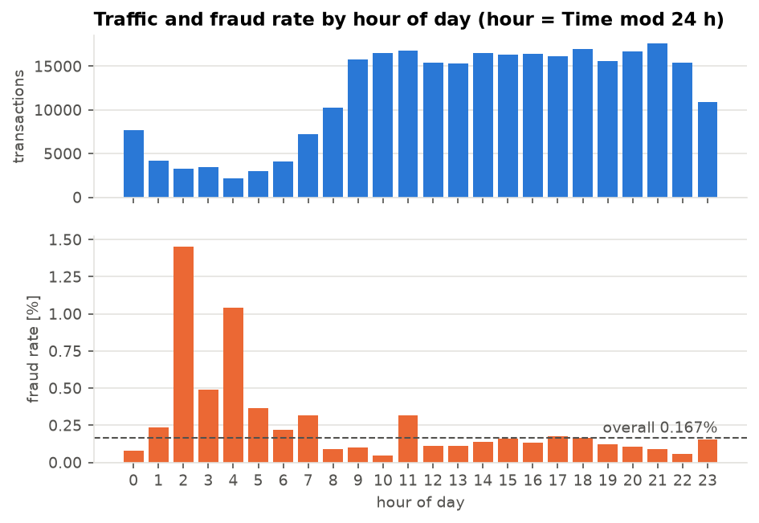

*Figure 1. Traffic volume (top) and fraud rate (bottom) by hour of day. The fraud rate peaks
when traffic is lowest.*

## 3. Model and training

**Architecture.** Symmetric multilayer-perceptron autoencoder 31 → 20 → 10 → **5** → 10 → 20 →
31 with ELU activations and a linear output layer (1 836
parameters). BatchNorm is off by default because inference-time batch statistics distort
per-sample anomaly scores (tested as an ablation in Section 6.3).

**Training.** Mean-squared-error loss on the 169 952
legitimate training rows; Adam (learning rate 10⁻³, weight decay 10⁻⁵), batch size 512, up to
100 epochs with early stopping (patience 10) and a plateau learning-rate scheduler. Model
selection uses the MSE on the 56 651
*legitimate* validation rows, so no fraud label influences training. Everything is
deterministic for a given seed (seeded manual mini-batching, deterministic PyTorch kernels):
two runs with the same seed give identical losses and a byte-identical checkpoint.

**Result.** Validation MSE falls to 0.420
(best epoch 99 of
100; training MSE
0.418) in
34 s on a CPU (Figure 2). The epoch cap
binds before early stopping; a 200-epoch run (Section 6.3) lowers the MSE to
0.407 without changing the
detection result.

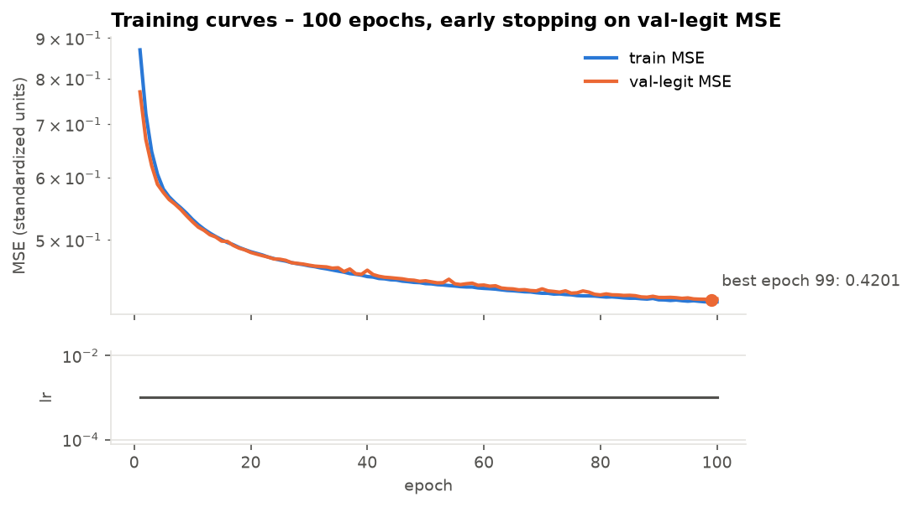

*Figure 2. Training and validation (legitimate rows) MSE per epoch, learning rate below.*

## 4. Scoring and threshold selection

**Anomaly score.** The primary score is the per-transaction mean squared reconstruction
residual, `mse(x) = ‖x − AE(x)‖² / 31`, as prescribed by the project. Two variants that
whiten the residual with statistics of legitimate validation residuals were also implemented:
`standardized` (per-feature z-scores, squared and summed) and `mahalanobis` (full residual
covariance). Higher is more anomalous for all three.

**Threshold.** The alarm rule is `score > τ`. τ is the (1 − 0.009) quantile of the scores of
the *legitimate validation rows*: by construction about 0.9 % of legitimate traffic alarms,
leaving a margin below the 1 % limit for sampling noise, and no fraud label is consulted. On
the validation split this gives τ = 1.862, FPR
0.900 % and – read only for information, not for
tuning – a validation recall of 84.3 % on
236 validation frauds (Figure 3). Two
semi-supervised alternatives (Youden's J, maximum F1) use validation fraud labels and were
evaluated for comparison only; Youden's J lands at 2–2.5 % FPR and therefore cannot satisfy
the criterion.

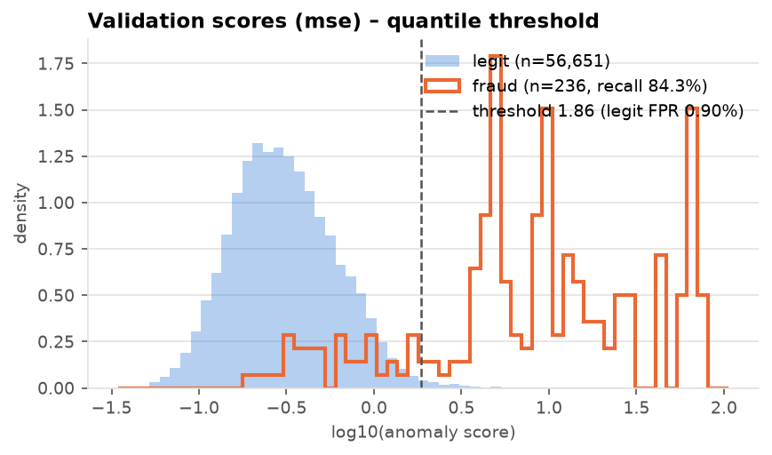

*Figure 3. Distribution of log₁₀(MSE) for legitimate and fraudulent validation transactions
with the chosen threshold.*

## 5. Evaluation protocol

All test-set numbers come from one evaluation pass per run (`metrics.json`) at the
validation-chosen threshold:

* **At the threshold:** confusion matrix, recall, FPR, precision, F1; Wilson 95 % intervals for
  every proportion; a stratified 1 000-sample bootstrap (legitimate and fraudulent rows resampled
  separately) as a cross-check.
* **Threshold-free (ranking quality):** ROC-AUC, average precision (PR-AUC) and recall at an
  *oracle* FPR of 0.1 / 0.5 / 1 / 2 % (threshold set on the test legitimate scores themselves).
  Comparing the oracle recall at 1 % with the recall at the transferred threshold separates
  "the score cannot rank the frauds" from "the threshold did not transfer".
* **Verdict:** `meets_target` = recall ≥ 85 % and FPR < 1 % on the point estimates, as the
  criterion is stated; the intervals qualify the verdict.
* **Decision gate.** The protocol fixed in advance: if the pre-registered configuration fails,
  run the disclosed variants (scoring method, bottleneck 3/8, no time feature, five seeds) and
  report all of them; never tune on the test set.

## 6. Results

### 6.1 Primary result: the criterion is not met

| Test set: 56 650 legitimate / 237 fraudulent | Value |
|---|---:|
| True positives / false positives / true negatives / false negatives | 183 / 541 / 56 109 / 54 |
| **Recall** (Wilson 95 %) | **77.2 %** [71.5 %, 82.1 %] |
| Recall, bootstrap 95 % | [71.7 %, 82.3 %] |
| **FPR** (Wilson 95 %) | **0.955 %** [0.878 %, 1.038 %] |
| Precision / F1 | 25.3 % / 0.381 |
| ROC-AUC / PR-AUC | 0.938 / 0.538 |
| Recall at oracle FPR 0.1 % / 0.5 % / 1 % / 2 % | 47.3 % / 74.7 % / 77.2 % / 78.9 % |
| Criterion (TP ≥ 202, FP ≤ 566) | **not met** (FPR part: met; recall part: not met) |

The threshold transferred as designed – the test FPR of 0.955 %
is below 1 % – but the detector finds 183 of the
237 test frauds where 202 were
required. The upper end of the confidence interval
(82.1 %) is below 85 %, so the miss is not
a sampling accident.

### 6.2 Ranking analysis: a fifth of the frauds look legitimate

Recall at an oracle 1 % FPR is 77.2 % – the same as
at the transferred threshold – and the recall-vs-FPR curve (Figure 4) is almost flat between
0.3 % and 2 % FPR (74.7 % at 0.5 %,
78.9 % at 2 %); it crosses 85 % only near 7 % FPR.
The limitation is therefore the *ranking*: about
21 % of the test frauds obtain
reconstruction errors indistinguishable from legitimate traffic, and no threshold choice can
recover them. The threshold sweep (Figure 5) shows the same plateau from the other side, and
the test-score histogram (Figure 6) the bimodal fraud distribution behind it.

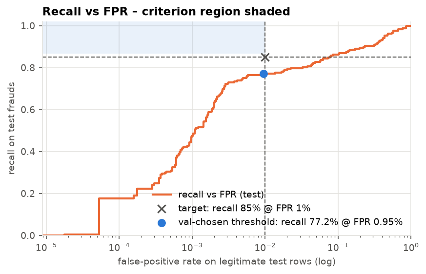

*Figure 4. Recall as a function of FPR on the test set (log axis). The shaded box is the
criterion region; the dot is the validation-chosen operating point.*

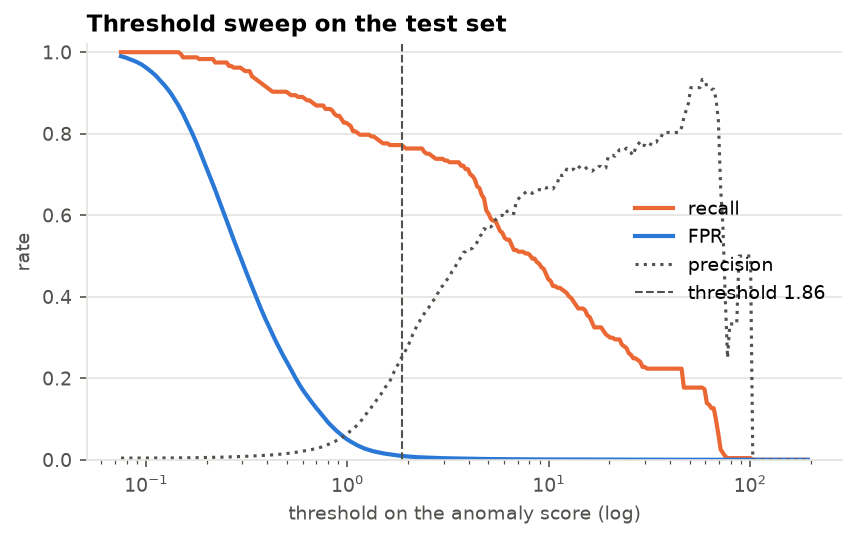

*Figure 5. Recall, FPR and precision as functions of the threshold.*

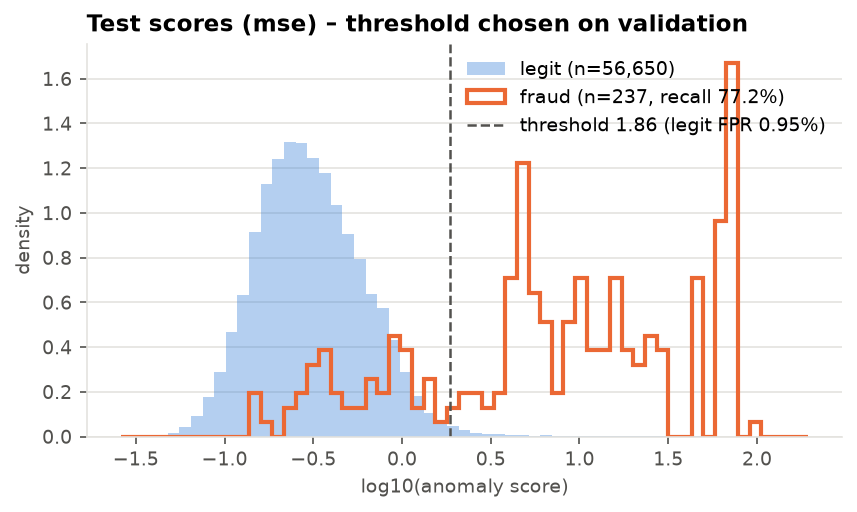

*Figure 6. Distribution of log₁₀(MSE) on the test set with the validation-chosen threshold.*

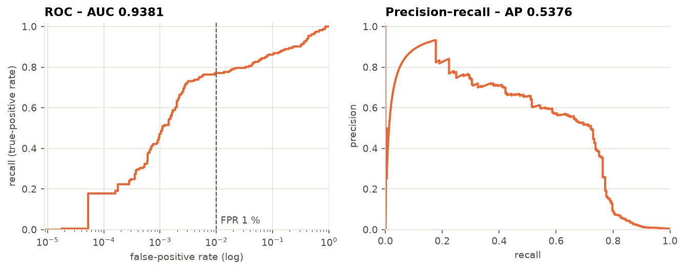

*Figure 7. ROC (log FPR axis) and precision-recall curves of the base model on the test set.*

### 6.3 Ablations (decision gate)

Every variant is a separate run directory produced by the same three commands; the threshold is
always the 0.9 % validation-legitimate quantile of the variant's own scores.

| Variant | Val recall | Test FPR | Test recall [Wilson 95 %] |
|---|---:|---:|---|
| Base: `mse`, latent 5, 31 inputs, seed 42 | 84.3 % | 0.955 % | **77.2 %** [71.5 %, 82.1 %] |
| Score `standardized` | 84.7 % | 0.990 % | 76.4 % [70.6 %, 81.3 %] |
| Score `mahalanobis` | 85.2 % | 0.934 % | 77.6 % [71.9 %, 82.5 %] |
| Latent 3 | 83.9 % | 0.923 % | 78.5 % [72.8 %, 83.2 %] |
| Latent 8 | 84.7 % | 0.987 % | 77.6 % [71.9 %, 82.5 %] |
| No hour-of-day feature (29 inputs) | 85.6 % | 0.932 % | 78.5 % [72.8 %, 83.2 %] |
| BatchNorm | 84.3 % | 1.001 % | 75.9 % [70.1 %, 80.9 %] |
| 200 epochs | 84.3 % | 0.999 % | 77.2 % [71.5 %, 82.1 %] |

No variant meets the criterion. Selecting on validation – the only honest selection rule –
would pick the Mahalanobis score (85.2 %
on validation), which yields 77.6 % on
test; the two best test numbers (latent 3, no time feature) are within one interval width of
the base model and were not chosen by any validation signal. BatchNorm lowers recall and pushes
the FPR to 1.001 %, failing both halves, which
supports keeping it off. Longer training changes the reconstruction error but not the
detection result.

### 6.4 Seed variance

The base configuration was trained with five seeds (0, 1, 2, 3, 42):

| | Mean ± sample std | Min – max |
|---|---:|---|
| Validation recall | 83.7 % ± 0.6 % | 83.1 % – 84.3 % |
| Test recall | 76.5 % ± 0.6 % | 75.9 % – 77.2 % |
| Test FPR | 0.920 % ± 0.028 % | 0.881 % – 0.955 % |

Seed-to-seed variation is below one percentage point, whereas validation recall exceeds test
recall by about
7.2 pp
for every seed and every variant (Figure 8): the random half of the frauds assigned to
validation is systematically easier than the half assigned to test. With 236 / 237 frauds per
half this is within the expected sampling variation of a 50/50 fraud split, but it is the
reason a validation-based estimate of "about 84 %" could not be confirmed on the test set.

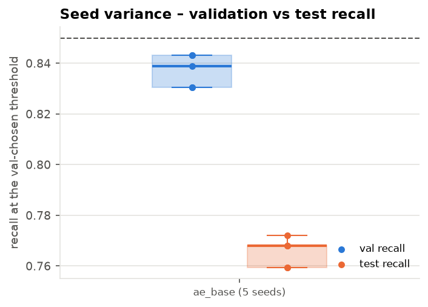

*Figure 8. Validation and test recall of the base configuration across five seeds.*

### 6.5 Baselines

PCA reconstruction error (a linear autoencoder) with k = 5, 10, 15 components and a 200-tree
Isolation Forest were fitted on the same training rows, thresholded by the same
validation-legitimate quantile and scored by the same evaluator.

| Model (random split, 237 test frauds) | ROC-AUC | Test FPR | Test recall [Wilson 95 %] |
|---|---:|---:|---|
| **Autoencoder** (base) | 0.938 | 0.955 % | **77.2 %** [71.5 %, 82.1 %] |
| PCA k = 15 (55.8 % variance) | 0.940 | 0.953 % | 70.0 % [63.9 %, 75.5 %] |
| PCA k = 10 (39.1 % variance) | 0.934 | 0.950 % | 59.9 % [53.6 %, 65.9 %] |
| PCA k = 5 (21.8 % variance; same bottleneck as the AE) | 0.933 | 0.909 % | 58.6 % [52.3 %, 64.7 %] |
| Isolation Forest (200 trees) | 0.940 | 0.967 % | 56.1 % [49.8 %, 62.3 %] |

At the same FPR the non-linear AE detects
18.6 pp more
of the frauds than the linear autoencoder with the same five-dimensional bottleneck and
21.1 pp more
than the Isolation Forest, although all ROC-AUCs lie between
0.933 and
0.940.
The ROC-AUC averages over all operating points and hides the difference; the advantage of the
AE is concentrated in the low-FPR region that matters for an alerting system (Figure 9). None
of the baselines approaches the criterion either.

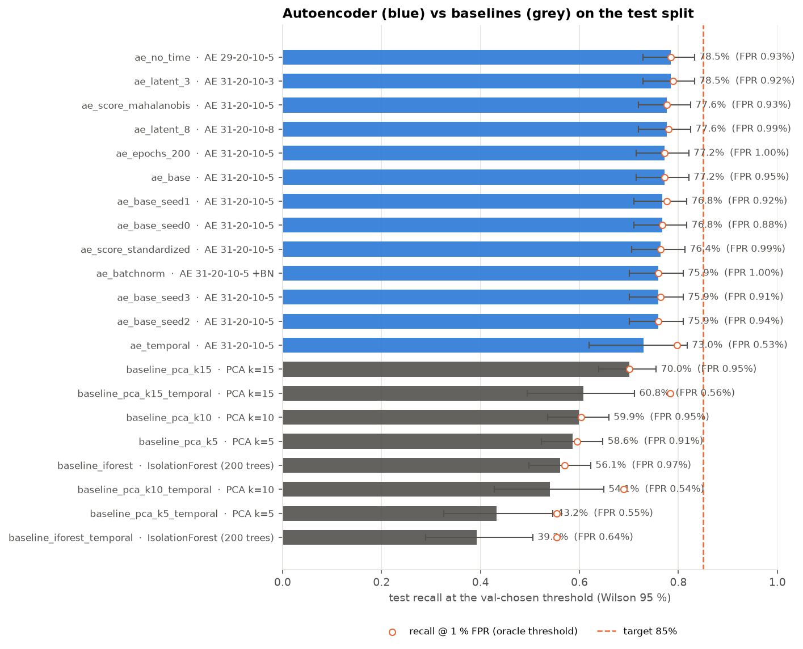

*Figure 9. Test recall at the validation-chosen threshold for every run, with Wilson 95 %
intervals; hollow markers show the oracle recall at 1 % FPR.*

### 6.6 Temporal split (concept drift)

The random split is the protocol used in the literature on this dataset, but a deployed
system is trained on the past and applied to the future. In the temporal variant the
legitimate transactions are ordered by `Time` and cut 60 / 20 / 20 %; frauds are assigned to
the validation or test window by their own time stamp, and the
342 frauds that
fall into the training window are dropped (training stays legitimate-only). This leaves
57 validation and
74 test frauds, so intervals
are wide.

| Model (temporal split, 74 test frauds) | ROC-AUC | Test FPR | Test recall [Wilson 95 %] | Recall at oracle 1 % FPR |
|---|---:|---:|---|---:|
| Autoencoder | 0.951 | 0.528 % | 73.0 % [61.9 %, 81.8 %] | 79.7 % |
| PCA k = 15 | 0.963 | 0.558 % | 60.8 % [49.4 %, 71.1 %] | 78.4 % |
| PCA k = 10 | 0.959 | 0.542 % | 54.1 % [42.8 %, 64.9 %] | 68.9 % |
| PCA k = 5 | 0.954 | 0.553 % | 43.2 % [32.6 %, 54.6 %] | 55.4 % |
| Isolation Forest | 0.951 | 0.643 % | 39.2 % [28.9 %, 50.6 %] | 55.4 % |

Two effects appear. First, the validation-legitimate threshold transfers to an FPR of only
0.528 % on later traffic: the score distribution of
legitimate transactions drifts downwards within two days, so a fixed quantile becomes
conservative and costs the AE
6.8 pp
of recall relative to the oracle 1 % operating point. In production the quantile would be
re-estimated on a rolling window of recent traffic. Second, the ranking itself is unaffected:
the oracle recall at 1 % FPR (79.7 %) is in line
with the random-split figure (77.2 %), and the AE stays ahead of every baseline.

### 6.7 Which features drive the detection

The mean squared residual per input feature (Figure 10) is largest, relative to legitimate
traffic, on V17,
V14, V12,
V10 and V16
– the components that supervised studies on this dataset also identify as the most
discriminative. `Amount` and the hour-of-day pair contribute little, which is consistent with
the no-time ablation.

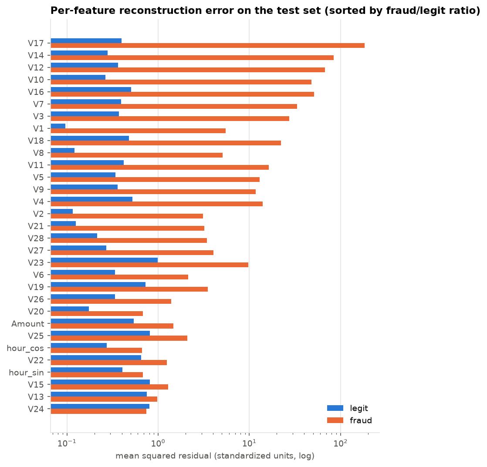

*Figure 10. Mean squared reconstruction residual per feature for legitimate and fraudulent test
transactions, sorted by their ratio.*

### 6.8 Pooled-fraud protocol, repeated splits and diagnosis (v2)

The v1 protocol put half of the frauds into validation although the threshold never reads a
fraud label (Section 4). Under the *pooled protocol* the legitimate split is unchanged, every
fraud is a test fraud and the checkpoint is byte-identical to `runs/ae_base`; only the
measurement changes. Re-drawing the legitimate split with five data seeds (train seed fixed)
separates split variance from the sampling interval.

| Measurement of the same legit-only AE | Test frauds | Test FPR | Test recall [Wilson 95 %] |
|---|---:|---:|---|
| v1 split (Section 6.1) | 237 | 0.955 % | 77.2 % [71.5 %, 82.1 %] |
| pooled protocol, same split | 473 | 0.955 % | **80.8 %** [77.0 %, 84.1 %] |
| pooled, five re-drawn legit splits (mean ± std) | 473 | 0.87 % – 1.01 % | 80.8 % ± 1.1 pp |
| literature protocol (no duplicate removal, all frauds in test) | 492 | 0.865 % | 82.3 % [78.7 %, 85.4 %] |
| PCA k = 15, pooled | 473 | 0.953 % | 73.2 % [69.0 %, 76.9 %] |
| Isolation Forest, pooled | 473 | 0.967 % | 57.5 % [53.0 %, 61.9 %] |

The v1 validation (84.3 %) and test
(77.2 %) halves are two draws of one
80.8 % detector; the interval is half as wide
and the criterion (403 of 473 frauds) is still
not met. The literature row gains about 1.5 pp from
duplicated frauds and a lower FPR and is shown for comparability only.

**Diagnosis of the missed frauds** (`fraud-ae diagnose`, Figure 11). The
91 missed frauds have a median score of
0.617 (legitimate
0.292, detected frauds
11.4), i.e. the
83.7th
percentile of legitimate scores while the threshold sits at the 99.1st; their median amount is
4.49 and they are spread
over the day. On the five most separating features
(V17,
V14,
V12,
V10,
V16) detected frauds average
-8.4 to
-5.1 standard
deviations, missed frauds -1.9 to
1.6 – they lie on the
legitimate manifold. The other detectors do not see them either: at their own thresholds PCA
k = 15 alarms on 2 of
the 91, the Isolation Forest on
7; the union of all
four detectors reaches 82.5 %
at 1.77 % FPR and rank-average
fusion 79.1 % at
1.00 %. No unsupervised
combination reaches 85 %.

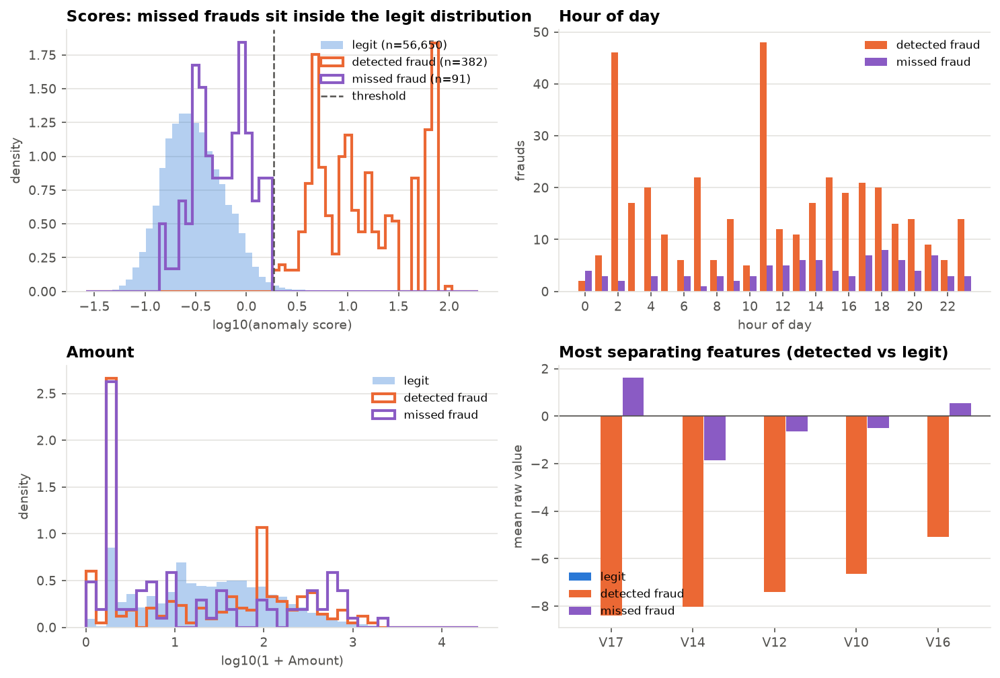

*Figure 11. Missed vs detected frauds under the pooled protocol: score densities, hour of day,
amount and the means of the most separating features.*

### 6.9 The legit-only ceiling (v2)

Six legit-only candidates were run on data seed 0 under a pre-registered rule (best pooled
recall with FPR < 1 % is re-run on data seeds 1–4 next to the base AE; configs
`configs/v2_unsup_*.toml`, table `results/v2_unsupervised.md`).

| Candidate (data seed 0; base AE 79.7 % at 0.964 %) | Test FPR | Test recall [Wilson 95 %] | Recall at oracle 0.1 % FPR |
|---|---:|---|---:|
| legit split 80 / 10 / 10 (a third more training rows) | 0.763 % | **81.0 %** [77.2 %, 84.3 %] | 60.9 % |
| night / day legit quantiles (hour-segmented threshold) | 0.941 % | 79.9 % [76.1 %, 83.3 %] | 55.4 % |
| variational AE, reconstruction probability [3] | 0.932 % | 79.3 % [75.4 %, 82.7 %] | 44.2 % |
| z(log MSE) + z(latent GMM NLL), 8 components | 0.897 % | 55.0 % [50.5 %, 59.4 %] | 20.5 % |
| latent GMM NLL alone | 0.884 % | 9.9 % [7.6 %, 13.0 %] | 1.7 % |

The 80 / 10 / 10 split won the selection but not the confirmation: over the five splits it
averages 81.1 % ±
0.9 pp
against 80.8 % ±
1.1 pp
for the base AE, a paired difference within noise; the best single split is
82.5 %.
Two negative results are worth stating: the latent code of the 5-D bottleneck carries no
usable density signal for this fraud population (the GMM term costs 25–28 pp when added to the
residual), and the VAE's reconstruction probability equals plain MSE at 1 % FPR but is clearly
worse at 0.1 % FPR because the learned per-feature variance down-weights exactly the
high-residual features. **The ceiling of the legit-only setting on this feature set is
≈ 81–82 % recall at 1 % FPR**, consistent with the diagnosis of Section 6.8.

### 6.10 Labels inside the model (v2)

The 473 frauds are cut into five fixed folds. The fold-*k* model is
fitted on all training legitimate rows plus the frauds of the other folds, takes its threshold
from the 0.9 % quantile of its scores on the legitimate validation rows (never a fraud label),
and scores only the fold-*k* rows; scores are divided by the fold threshold, so every method
is evaluated out-of-fold on all 473 frauds at the common threshold 1.0 (`results/v2_supervised.md`).
Hyper-parameters are fixed in `configs/v2_supervised.toml`. Every method is also trained with
25 / 50 / 100 labelled frauds per fold (`results/v2_few_label.md`, Figure 13).

| Method (out-of-fold, all labels) | Test FPR | Recall [Wilson 95 %] | 25 / 50 / 100 labels per fold |
|---|---:|---|---|
| gradient boosting on `[x, AE residual, AE score]` | 0.886 % | **89.6 %** [86.6 %, 92.1 %] | 82.0 % / 83.9 % / 83.9 % |
| gradient boosting, class-weighted (`hgb`) | 0.909 % | **89.2 %** [86.1 %, 91.7 %] | 82.0 % / 84.6 % / 85.2 % |
| logistic regression, class-weighted | 0.918 % | **88.8 %** [85.6 %, 91.3 %] | 74.8 % / 82.7 % / 85.6 % |
| gradient boosting, legit under-sampled 20 : 1 | 0.920 % | **88.4 %** [85.2 %, 91.0 %] | 83.9 % / 86.0 % / 87.1 % |
| logistic regression on `[x, AE residual, AE score]` | 0.879 % | 88.2 % [84.9 %, 90.8 %] | 71.5 % / 78.6 % / 83.3 % |
| **the AE**, fine-tuned with a margin loss on frauds (`neg_ae`) | 0.941 % | 87.3 % [84.0 %, 90.0 %] | 81.4 % / 83.7 % / 84.4 % |
| MLP 31-20-10-1, balanced mini-batches | 0.803 % | 86.9 % [83.6 %, 89.6 %] | 73.6 % / 81.0 % / 82.9 % |
| the AE with a Deep-SAD latent term [9] | 0.902 % | 86.7 % [83.3 %, 89.4 %] | 83.1 % / 84.6 % / 84.4 % |
| legit-only AE (Section 6.8, no labels) | 0.955 % | 80.8 % [77.0 %, 84.1 %] | – |

**The criterion is met** by every method that sees
the labelled frauds, the autoencoder itself included; four methods keep the whole interval
above 85 %. Labels buy
+8.9 pp
for the best classifier and
+6.6 pp
for the AE; tree models and the fine-tuned AEs degrade gracefully (25 labels per fold still add
1–3 pp over no labels, about 50 reach 85 % with under-sampled gradient boosting), while the
linear and MLP classifiers need ≥ 100 labels to beat the legit-only AE at all. The AE as an
extra feature changes gradient boosting by
0.4 pp
at all labels and by nothing or less at smaller budgets, and costs the linear model
0.6 pp:
once labels exist, the reconstruction residual adds nothing that gradient boosting cannot learn
from `x` itself. Precision at this operating point is 44–48 % for every labelled method.

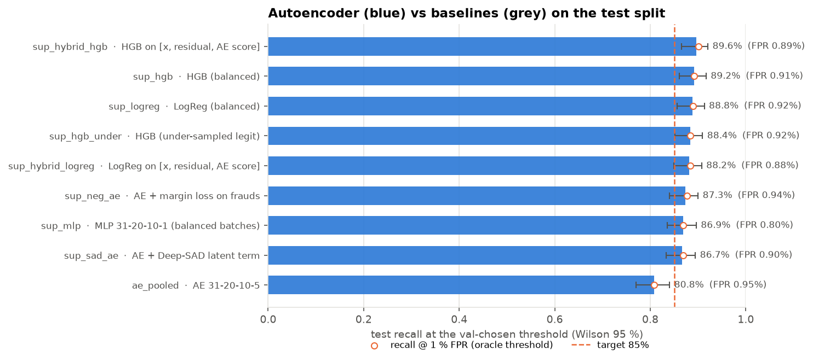

*Figure 12. Out-of-fold recall at FPR < 1 % of the eight labelled methods and the legit-only AE,
all 473 frauds, Wilson 95 % intervals.*

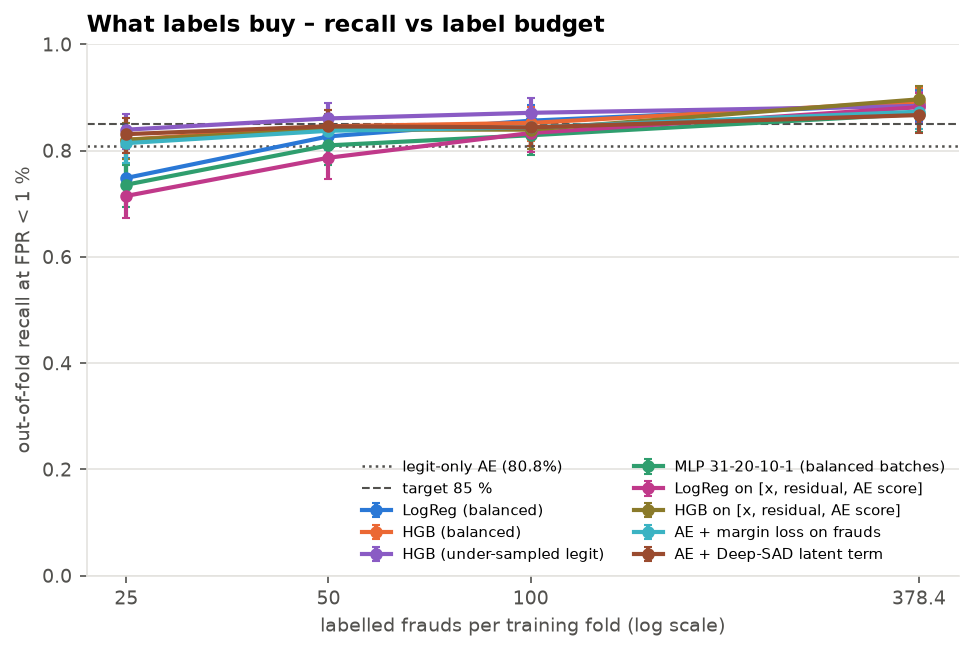

*Figure 13. Out-of-fold recall vs labelled frauds per training fold (25, 50, 100, all);
dashed line = legit-only AE.*

### 6.11 Robustness: rolling threshold, variance, evasion (v2)

**Rolling threshold** (Figure 14). On the temporal split of Section 6.6 the models see the
first 60 % of traffic (the labelled ones also its
342 frauds); the last 40 % is cut into
8 windows of equal legitimate count (≈ 14 k rows), window 0
calibrates the fixed 0.9 % legit-quantile threshold (the v1 procedure) and windows 1–7
(123 frauds) are evaluated with it and with
the quantile re-estimated on the previous window's legitimate rows.

| Model | Fixed threshold: FPR mean (windows in [0.8 %, 1.0 %]) | Rolling threshold: FPR mean (in band) | Recall on the later frauds, rolling [Wilson 95 %] |
|---|---|---|---|
| legit-only AE | 0.71 % (4 / 7) | 0.85 % (4 / 7) | 77.2 % [69.1 %, 83.8 %] |
| gradient boosting (`hgb`) | **2.20 %** (0 / 7) | 1.05 % (4 / 7) | 85.4 % [78.1 %, 90.5 %] |
| AE + margin loss (`neg_ae`) | 1.00 % (0 / 7) | 0.88 % (4 / 7) | 85.4 % [78.1 %, 90.5 %] |

The fixed threshold is the failure mode, and worst for the supervised model, whose legitimate
scores drift upward after calibration; the AE drifts the other way (Section 6.6).
Re-estimating the quantile on the previous window removes the systematic error for all three
models. The remaining per-window spread (± 0.3 pp) is what binomial noise on 14 k rows allows
(standard error 0.08 pp), so "every window inside a 0.2-pp band" is not an attainable target
and the mean is the right criterion. Trained on the frauds of the first 60 % of traffic, both
labelled winners catch 85.4 %
of the later frauds – the supervised models did not merely memorise the two-day campaigns –
with a wide interval.

**Variance of the winners** (all labels, out-of-fold; model seeds and re-drawn legitimate
splits, each split with its own legit-only AE):

| Family | Group | Runs | Recall mean ± std (min – max) | FPR min – max | Every run ≥ 85 % |
|---|---|---:|---|---|:---:|
| `hgb` | model seed | 5 | 89.2 % ± 0.0 pp (89.2 % – 89.2 %) | 0.91 % – 0.91 % | true |
| `hgb` | legit split | 6 | 88.8 % ± 0.3 pp (88.6 % – 89.2 %) | 0.82 % – 0.93 % | true |
| `neg_ae` | model seed | 5 | 87.4 % ± 0.4 pp (86.9 % – 87.9 %) | 0.90 % – 1.00 % | true |
| `neg_ae` | legit split | 6 | 87.2 % ± 0.6 pp (86.3 % – 87.9 %) | 0.84 % – 0.96 % | true |

Gradient boosting without early stopping or subsampling is deterministic, so its model-seed
spread is zero by construction; the split-to-split spread of both winners is far inside the
Wilson half-width, and every run clears the criterion.

**Evasion probe** (Figure 15). For each of the 382 test frauds the
legit-only AE detects, projected gradient descent [10] on the input minimises the score inside
an L2 ball of radius ε in standardised feature units (white-box, two starts, best iterate; no
feasibility constraints). Within ε = 1 – about one standard deviation of a single feature –
1.6 % of the detected frauds cross below the
threshold, within ε = 4 11.5 %, within
ε = 8 34.3 %; the median minimal budget is
**12** against a median L2 norm of
20.3 for a detected fraud, and
98 frauds are not evaded within ε = 24. The perturbation moves
V17, V14 and
V12 most – the components that separate frauds in the
first place (Section 6.7). An attacker with the gradients therefore has to move a typical fraud
more than half of the way to the mean legitimate transaction; since `V1..V28` are PCA
components of undisclosed fields, the cost in the real feature space is higher still.

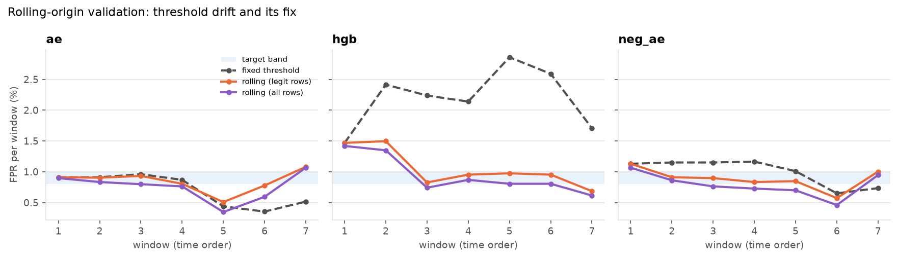

*Figure 14. FPR per window on the temporal split with the fixed window-0 threshold and with the
quantile re-estimated on the previous window; shaded band = [0.8 %, 1.0 %].*

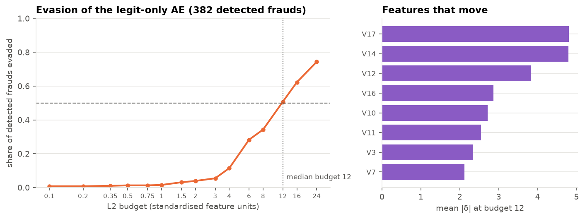

*Figure 15. Share of detected frauds pushed below the AE threshold as a function of the L2
budget, and the features that move at the median budget.*

## 7. Discussion

**Why 85 % is out of reach for the legit-only detector family.** Reconstruction-error detectors flag
transactions that lie off the manifold of legitimate traffic. The frauds the AE misses are
those that lie *on* it: their `V`-profile, amount and hour are unremarkable one transaction at a
time. The ablations show that this is not a matter of capacity (latent 3 vs 8), optimisation
(100 vs 200 epochs), normalisation, score whitening or seed: every configuration misses the
same fifth. Distinguishing these frauds requires information that the row does not carry –
the card-holder's history, velocity, merchant, device – i.e. *contextual* rather than *point*
anomaly detection – or labels (Section 6.10).

**What labels buy, and what the AE buys.** With the labelled frauds inside the model every
method clears the criterion out-of-fold, including the autoencoder with a margin loss; the
Phase 8 ceiling was a ceiling of the *legit-only* setting, not of the feature set. The missed
frauds are not separable by distance from the legitimate manifold but they are separable by a
decision boundary learned from examples. Conversely, once labels exist the AE residual adds
nothing to gradient boosting: the two routes are complementary in *what they need* (labels
versus none) rather than in *what they see*. A deployment would run the supervised classifier
for recall on known fraud patterns next to the legit-only AE for departures from normal traffic
that no label has described yet, both behind a rolling threshold.

**Validation versus test.** The project's pre-registered protocol (threshold and model
selection on validation, a single evaluation pass on test) exposed a 7-point gap between the
two fraud halves that would have been invisible had the threshold been tuned on test or the
frauds pooled. We report it as a finding rather than re-splitting until the gap disappears.

**Against the literature.** Published reconstruction-error autoencoders on this dataset reach
recall of roughly 0.80–0.90 at about 1 % FPR under random splits with all frauds in the test
set, pooled thresholds and without duplicate removal. Our setting is stricter on each point;
the literature-protocol row of Section 6.8 (82.3 %
on 492 frauds) reproduces the lower end of that band and shows
where the difference comes from (duplicated frauds, a lower FPR).

## 8. Limitations and threat-model discussion

* **Point-anomaly detector.** Each transaction is scored in isolation. An attacker who keeps
  individual transactions inside the card-holder's usual envelope (small amounts, usual hours)
  is invisible by construction; such patterns are only detectable from account history.
* **Obfuscated features.** `V1..V28` are PCA components of undisclosed original fields; no
  merchant, country, channel or account identifier is available, so velocity and limit-based
  features cannot be built and the results do not transfer directly to a bank's raw data.
* **Two days of data, one geography.** Section 6.11 measures the drift: a fixed legit-quantile
  threshold runs the supervised winner at 2.20 %
  FPR within the second day; rolling re-estimation on the previous window restores the mean
  but cannot remove the ± 0.3 pp sampling spread of 14 k-row windows. Seasonal effects and the
  stability of the supervised models beyond the two recorded days are outside what this dataset
  can show; the labelled winners were checked on 123
  later frauds only.
* **Adversarial evasion – measured.** The AE is differentiable, and Section 6.11 gives the
  white-box cost: a median L2 budget of 12
  standardised units per detected fraud, 1.6 %
  of them within one unit. The probe is an upper bound on attacker power (full gradient access,
  PCA components set directly, no feasibility constraints); the gradient-boosting winner is not
  differentiable and was not probed. Hardening (score randomisation, ensembles, rate-limited
  scoring, retraining) is discussed in the literature and not implemented here.
* **Label noise and base rate.** The dataset labels are themselves the output of a fraud
  process; the base rate (0.167 %)
  means that even at the criterion three of four alarms would be false, which bounds the
  operational value of any detector at this operating point.
* **Statistical power.** 237 test frauds give ±5-point intervals;
  differences smaller than that between variants are not resolvable here.

## 9. Conclusions

1. A 1 836-parameter autoencoder trained only on legitimate transactions, with a threshold set
   on legitimate validation data, detects **77.2 %** of
   the v1 test frauds and **80.8 %**
   (77.0 % – 84.1 %)
   of all 473 frauds at an FPR below 1 %. The FPR criterion is met;
   the 85 % recall criterion is **not met** in
   the legit-only setting, and the interval excludes it.
2. The shortfall is a ceiling of the legit-only approach, not of this model: v1 variants, more
   training data, a VAE, latent-density scores and hour-segmented thresholds all stay at
   ≈ 80–82 %. The 91 missed frauds lie on the
   legitimate manifold and no unsupervised ensemble reaches 85 %
   (union 82.5 % at
   1.77 % FPR).
3. The autoencoder is nonetheless the best unsupervised detector in the study by a wide margin:
   +7.6 pp
   over the best PCA baseline and
   +23.3 pp
   over the Isolation Forest at the same FPR on 473 frauds, and ahead on the temporal split.
4. **With labels the criterion is met.** Evaluated out-of-fold over all 473 frauds with
   legit-only thresholds, gradient boosting reaches
   **89.2 %** (86.1 % – 91.7 %)
   and the autoencoder fine-tuned with a margin loss
   **87.3 %**; about 50 labelled frauds per fold
   suffice for a tree model. The AE as an extra feature adds nothing measurable
   (0.4 pp).
5. A fixed legit-quantile threshold does not survive two days of traffic (the supervised
   winner would run at 2.20 %
   FPR); re-estimating the quantile on a rolling window of recent legitimate traffic is part of
   the detector, not an operational detail. Both labelled winners hold
   85.4 %
   recall on later frauds and ≥ 85 % across model seeds and legitimate splits.
6. Evading the legit-only AE costs a white-box attacker a median L2 budget of
   12 standardised units, more
   than half of a fraud's distance to the mean legitimate transaction, moved along the very
   features that make frauds detectable.
7. Recommendation: deploy the supervised classifier for recall on known fraud patterns together
   with the legit-only autoencoder for departures from normal traffic, both behind a rolling
   threshold, and treat account-level context as the next source of recall.

## 10. Reproducibility

Every number above is rendered from a JSON artifact by `fraud-ae report` (template:
`report/report_template.md`); a unit test fails if the committed report and the artifacts
disagree. The v1 study is reproduced on a CPU in about ten minutes, the v2 study in about one
hour more:

```bash
uv sync --group dev
uv run fraud-ae all --config configs/base.toml --run runs/ae_base   # phases 1–4
scripts/run_ablations.sh                                           # all v1 variants, baselines, comparison
scripts/run_v2_protocol.sh                                         # 6.8: pooled protocol, data seeds, diagnosis (≈ 5 min)
scripts/run_v2_unsupervised.sh                                     # 6.9: legit-only candidates, pre-registered pick (≈ 8 min)
scripts/run_v2_supervised.sh                                       # 6.10: eight labelled methods, few-label curve (≈ 25 min)
scripts/run_v2_robustness.sh                                       # 6.11: variance runs, rolling threshold, evasion (≈ 12 min)
uv run fraud-ae report && scripts/check.sh                         # render this report; format, lint, tests
```

Artifact map: `data/processed*/data_report.json` (Section 2), `runs/<run>/train_summary.json`
(Section 3), `runs/<run>/threshold.json` (Section 4, validation columns),
`runs/<run>/metrics.json` (Sections 5–6), `results/comparison.md` (all 21 v1 runs in one table),
`runs/ae_pooled/diagnostics.json` (Section 6.8), `results/v2_{protocol,unsupervised,supervised,few_label}.md`
and `runs/sup_<method>/{folds.json,few_label.json}` (Sections 6.9–6.10),
`results/v2_robustness.json` (Section 6.11).
The prompt log of the AI-assisted development is in `report/prompt_log.md`; design decisions
are recorded in `ARCHITECTURE.md`.

## 11. References

1. Dal Pozzolo, A., Caelen, O., Johnson, R. A., & Bontempi, G. (2015). Calibrating probability
   with undersampling for unbalanced classification. *IEEE Symposium Series on Computational
   Intelligence (SSCI)*, 159–166.
2. ULB Machine Learning Group. *Credit Card Fraud Detection* dataset. Kaggle,
   https://www.kaggle.com/datasets/mlg-ulb/creditcardfraud
3. An, J., & Cho, S. (2015). Variational autoencoder based anomaly detection using
   reconstruction probability. *Special Lecture on IE*, 2(1), 1–18.
4. Sakurada, M., & Yairi, T. (2014). Anomaly detection using autoencoders with nonlinear
   dimensionality reduction. *Proceedings of the MLSDA Workshop*, 4–11.
5. Liu, F. T., Ting, K. M., & Zhou, Z.-H. (2008). Isolation Forest. *IEEE International
   Conference on Data Mining (ICDM)*, 413–422.
6. Chandola, V., Banerjee, A., & Kumar, V. (2009). Anomaly detection: A survey. *ACM Computing
   Surveys*, 41(3), 1–58.
7. Wilson, E. B. (1927). Probable inference, the law of succession, and statistical inference.
   *Journal of the American Statistical Association*, 22(158), 209–212.
8. PyTorch documentation, https://pytorch.org/docs/ ; scikit-learn documentation,
   https://scikit-learn.org/stable/
9. Ruff, L., Vandermeulen, R. A., Görnitz, N., Binder, A., Müller, E., Müller, K.-R., &
   Kloft, M. (2020). Deep semi-supervised anomaly detection. *International Conference on
   Learning Representations (ICLR)*.
10. Madry, A., Makelov, A., Schmidt, L., Tsipras, D., & Vladu, A. (2018). Towards deep learning
    models resistant to adversarial attacks. *International Conference on Learning
    Representations (ICLR)*.
