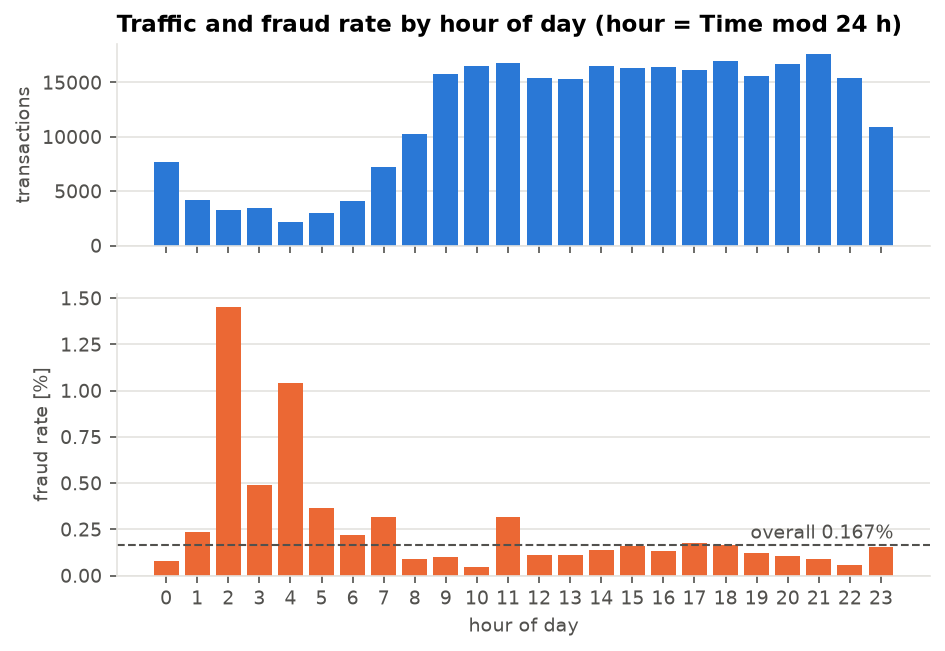
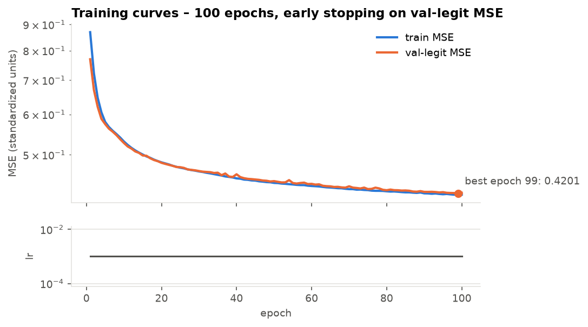
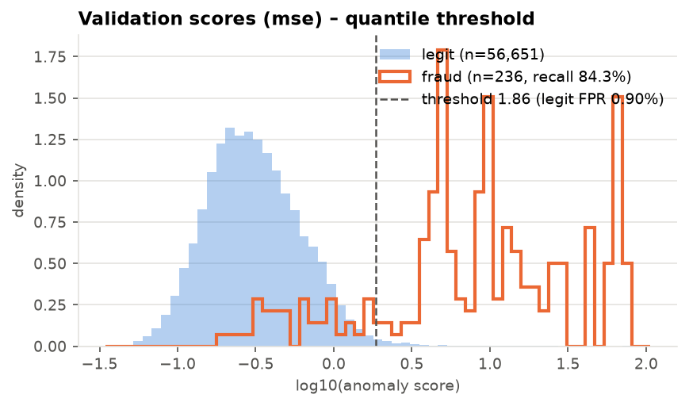
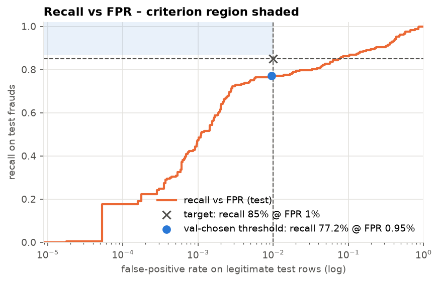
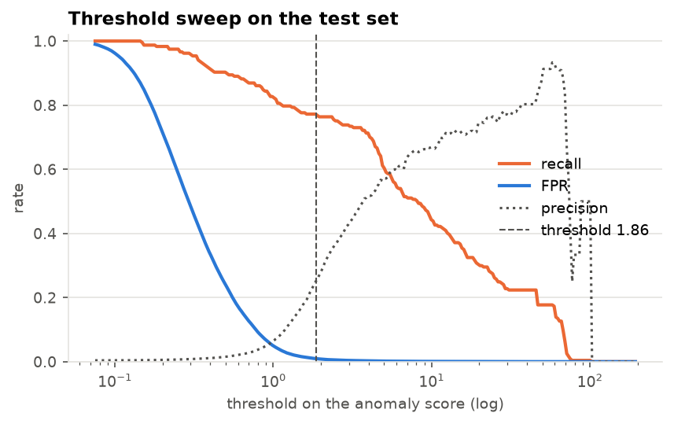
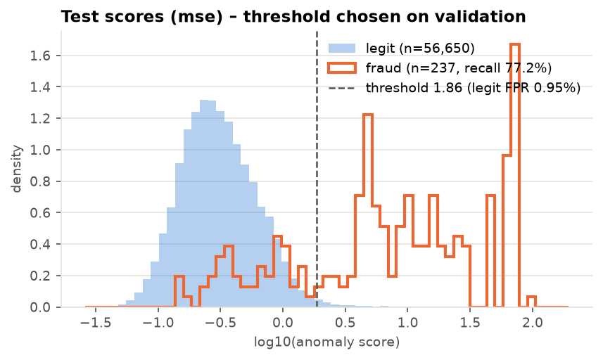
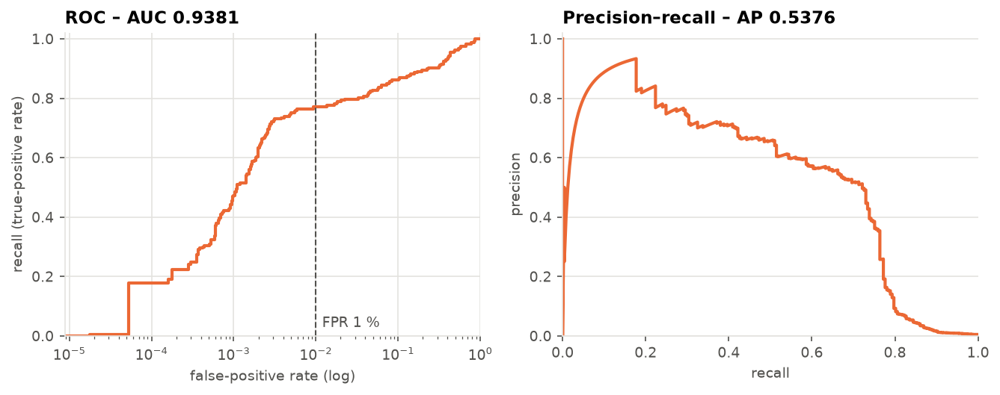
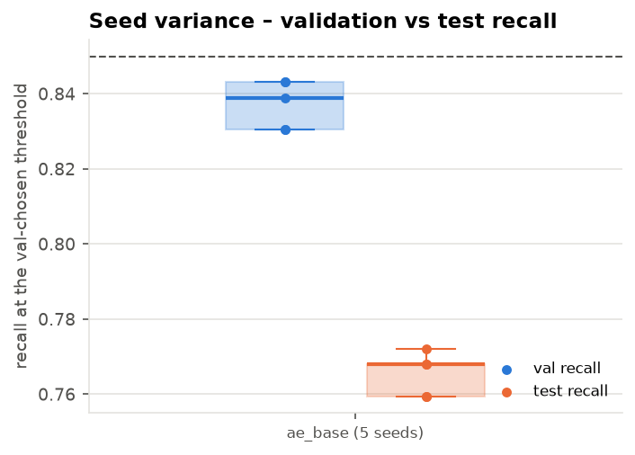
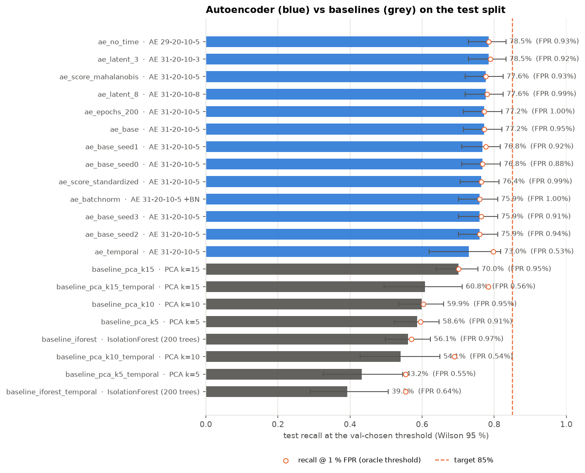
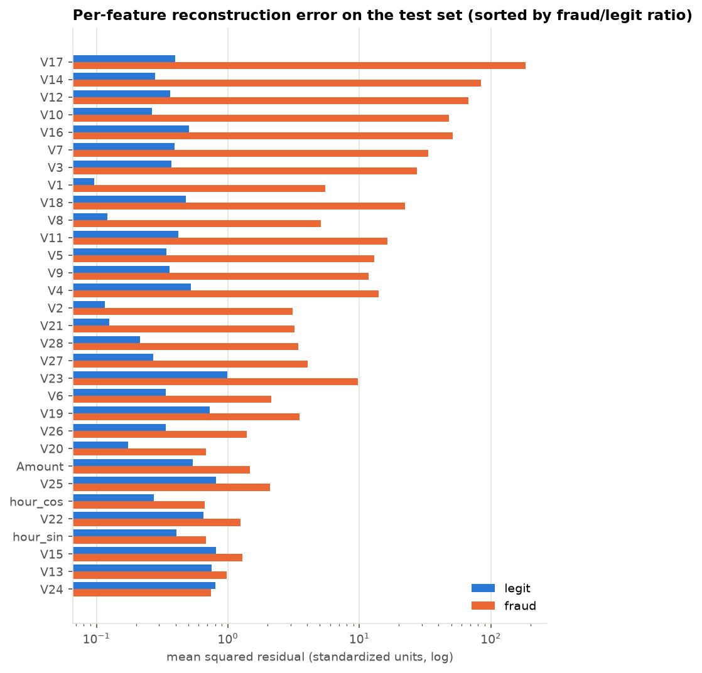

<!-- TEMPLATE: every number inside a double-brace placeholder is read from a JSON artifact by `fraud-ae report`.
     Edit this file, not report.md. See src/fraud_ae/report.py for the placeholder syntax. -->
# Fraud Detection in Bank Transactions with a Deep Autoencoder

**ZTKIK – Project 12.** Deep autoencoder trained on legitimate credit-card transactions only;
fraud is flagged by a high reconstruction error. Code, configs and every artifact behind this
report: repository root (`README.md`, `ARCHITECTURE.md`, `ROADMAP.md`, `report/CHANGELOG.md`).

## Abstract

We train a 31-20-10-5-10-20-31 autoencoder (AE) in PyTorch on {{ ${runs/ae_base/train_summary.json:n_train} | int }}
legitimate transactions of the Kaggle *Credit Card Fraud Detection* dataset and flag a
transaction as fraudulent when its reconstruction error exceeds a threshold chosen on
legitimate validation data only. The project criterion is **recall ≥ 85 % at a false-positive
rate (FPR) < 1 %** on a held-out test set. On {{ ${runs/ae_base:n_fraud} }} test frauds and
{{ ${runs/ae_base:n_legit} | int }} legitimate test transactions the AE reaches a recall of
**{{ ${runs/ae_base:at_threshold.recall} | pct1 }}** (Wilson 95 % interval
{{ ${runs/ae_base:at_threshold.recall_ci_wilson.0} | pct1 }} – {{ ${runs/ae_base:at_threshold.recall_ci_wilson.1} | pct1 }})
at an FPR of {{ ${runs/ae_base:at_threshold.fpr} | pct3 }}: the FPR half of the criterion holds,
the recall half does not. Eleven disclosed variants (scoring method, bottleneck size, time
encoding, BatchNorm, training length, five seeds) stay within
{{ min(${runs/ae_base_seed2:at_threshold.recall}, ${runs/ae_base_seed3:at_threshold.recall}, ${runs/ae_batchnorm:at_threshold.recall}) | pct1 }} –
{{ max(${runs/ae_latent_3:at_threshold.recall}, ${runs/ae_no_time:at_threshold.recall}) | pct1 }},
so the shortfall is systematic. The AE nevertheless outperforms the classical baselines at the
same FPR by a wide margin: PCA reconstruction with the same five-dimensional bottleneck detects
{{ ${runs/baseline_pca_k5:at_threshold.recall} | pct1 }} of the frauds and an Isolation Forest
{{ ${runs/baseline_iforest:at_threshold.recall} | pct1 }}. We analyse why roughly a fifth of the
frauds reconstruct as well as legitimate traffic, report a temporal-split experiment, and
discuss the threat model and the limits of a point-anomaly detector on PCA-obfuscated features.

## 1. Problem, threat model and success criterion

**Setting.** Automated anti-fraud systems in electronic banking score every card transaction
and raise alarms that analysts or rule engines act upon. Labels are scarce, delayed and
expensive, so the project follows the *unsupervised* route: learn what legitimate traffic looks
like and treat departures from it as suspicious.

**Threat model.** The adversary (a "financial fraud / anomaly attacker") executes unauthorized
transactions with stolen card data that break the card-holder's usual pattern – amount, time of
day, merchant profile. The attacker does not see the model; the defence is a detector that,
given a single transaction's feature vector, must decide whether it is anomalous. Two
operational costs matter: a missed fraud (direct loss) and a false alarm (friction for a
legitimate customer, analyst time). The criterion from the project abstract fixes the trade-off:
**detect at least 85 % of frauds while raising false alarms on fewer than 1 % of legitimate
transactions.**

**What the criterion implies on this data.** With {{ ${runs/ae_base:n_legit} | int }}
legitimate and {{ ${runs/ae_base:n_fraud} }} fraudulent test transactions, FPR < 1 % allows at
most {{ ${runs/ae_base:criterion.fp_allowed} }} false alarms and recall ≥ 85 % requires at least
{{ ${runs/ae_base:criterion.tp_required} }} detected frauds. Even a detector that meets both
would have a precision of only about
{{ ${runs/ae_base:criterion.tp_required} / (${runs/ae_base:criterion.tp_required} + ${runs/ae_base:criterion.fp_allowed}) | pct0 }}
– roughly three alarms out of four would be legitimate transactions. This is the normal
operating regime of an alerting system on a {{ ${data/processed/data_report.json:class_balance.fraud_rate} | pct3 }}
base rate and must be stated alongside the recall figure.

## 2. Data and preprocessing

**Dataset.** Kaggle *Credit Card Fraud Detection* (ULB Machine Learning Group): two days of
European card transactions, {{ ${data/processed/data_report.json:rows.raw} | int }} rows with 28
PCA-transformed features `V1..V28`, the raw `Amount`, the elapsed `Time` in seconds and the
label `Class`. The CSV is verified against a pinned SHA-256 before use.

**Duplicates.** {{ ${data/processed/data_report.json:rows.duplicates_dropped} | int }} rows are
exact duplicates of another row; they are removed *before* splitting, otherwise identical
rows could appear in both training and test data. {{ ${data/processed/data_report.json:rows.after_dedupe} | int }}
rows remain, {{ ${data/processed/data_report.json:class_balance.fraud} }} of them frauds
({{ ${data/processed/data_report.json:class_balance.fraud_rate} | pct3 }}).

**Features (31 model inputs).** `V1..V28` unchanged; `Amount` → `log1p(Amount)` (heavy right
tail: median {{ ${data/processed/data_report.json:amount.all.median} | f2 }}, maximum
{{ ${data/processed/data_report.json:amount.all.max} | int }}); `Time` → hour of day →
`sin`/`cos` pair. The raw `Time` is a clock over a two-day window and would act as a row
identifier; the hour of day is a genuine signal: the fraud *rate* at 02:00 is
{{ ${data/processed/data_report.json:by_hour.fraud_rate.2} | pct2 }} and at 04:00
{{ ${data/processed/data_report.json:by_hour.fraud_rate.4} | pct2 }}, against
{{ ${data/processed/data_report.json:class_balance.fraud_rate} | pct3 }} overall, while traffic is
lowest at night (Figure 1). Fraud amounts are smaller in median
({{ ${data/processed/data_report.json:amount.fraud.median} | f2 }} vs
{{ ${data/processed/data_report.json:amount.legit.median} | f2 }}) but heavier-tailed.

**Split protocol (seed 42).** Legitimate rows are shuffled and divided 60 / 20 / 20 % into
train / validation / test; frauds are divided 50 / 50 between validation and test and **never
enter training**. The `StandardScaler` is fitted on the training rows only.

| Split | Legitimate | Fraud | Total |
|---|---:|---:|---:|
| train | {{ ${data/processed/data_report.json:splits.train.legit} | int }} | {{ ${data/processed/data_report.json:splits.train.fraud} }} | {{ ${data/processed/data_report.json:splits.train.total} | int }} |
| validation | {{ ${data/processed/data_report.json:splits.val.legit} | int }} | {{ ${data/processed/data_report.json:splits.val.fraud} }} | {{ ${data/processed/data_report.json:splits.val.total} | int }} |
| test | {{ ${data/processed/data_report.json:splits.test.legit} | int }} | {{ ${data/processed/data_report.json:splits.test.fraud} }} | {{ ${data/processed/data_report.json:splits.test.total} | int }} |

**Leakage controls** (all unit-tested): no fraud in training; the three index sets are disjoint
and cover the de-duplicated frame; the split is reproducible from the seed; scaler statistics
equal training statistics; no identical feature rows across splits; the threshold is chosen on
validation data only; test labels are read exactly once, by the evaluation step.



*Figure 1. Traffic volume (top) and fraud rate (bottom) by hour of day. The fraud rate peaks
when traffic is lowest.*

## 3. Model and training

**Architecture.** Symmetric multilayer-perceptron autoencoder 31 → 20 → 10 → **5** → 10 → 20 →
31 with ELU activations and a linear output layer ({{ ${runs/ae_base/train_summary.json:n_parameters} | int }}
parameters). BatchNorm is off by default because inference-time batch statistics distort
per-sample anomaly scores (tested as an ablation in Section 6.3).

**Training.** Mean-squared-error loss on the {{ ${runs/ae_base/train_summary.json:n_train} | int }}
legitimate training rows; Adam (learning rate 10⁻³, weight decay 10⁻⁵), batch size 512, up to
100 epochs with early stopping (patience 10) and a plateau learning-rate scheduler. Model
selection uses the MSE on the {{ ${runs/ae_base/train_summary.json:n_val_legit} | int }}
*legitimate* validation rows, so no fraud label influences training. Everything is
deterministic for a given seed (seeded manual mini-batching, deterministic PyTorch kernels):
two runs with the same seed give identical losses and a byte-identical checkpoint.

**Result.** Validation MSE falls to {{ ${runs/ae_base/train_summary.json:best_val_legit_mse} | f3 }}
(best epoch {{ ${runs/ae_base/train_summary.json:best_epoch} }} of
{{ ${runs/ae_base/train_summary.json:epochs_run} }}; training MSE
{{ ${runs/ae_base/train_summary.json:final_train_mse} | f3 }}) in
{{ ${runs/ae_base/train_summary.json:wall_seconds} | f0 }} s on a CPU (Figure 2). The epoch cap
binds before early stopping; a 200-epoch run (Section 6.3) lowers the MSE to
{{ ${runs/ae_epochs_200/train_summary.json:best_val_legit_mse} | f3 }} without changing the
detection result.



*Figure 2. Training and validation (legitimate rows) MSE per epoch, learning rate below.*

## 4. Scoring and threshold selection

**Anomaly score.** The primary score is the per-transaction mean squared reconstruction
residual, `mse(x) = ‖x − AE(x)‖² / 31`, as prescribed by the project. Two variants that
whiten the residual with statistics of legitimate validation residuals were also implemented:
`standardized` (per-feature z-scores, squared and summed) and `mahalanobis` (full residual
covariance). Higher is more anomalous for all three.

**Threshold.** The alarm rule is `score > τ`. τ is the (1 − 0.009) quantile of the scores of
the *legitimate validation rows*: by construction about 0.9 % of legitimate traffic alarms,
leaving a margin below the 1 % limit for sampling noise, and no fraud label is consulted. On
the validation split this gives τ = {{ ${runs/ae_base/threshold.json:value} | f3 }}, FPR
{{ ${runs/ae_base/threshold.json:val_fpr} | pct3 }} and – read only for information, not for
tuning – a validation recall of {{ ${runs/ae_base/threshold.json:val_recall} | pct1 }} on
{{ ${runs/ae_base/threshold.json:n_val_fraud} }} validation frauds (Figure 3). Two
semi-supervised alternatives (Youden's J, maximum F1) use validation fraud labels and were
evaluated for comparison only; Youden's J lands at 2–2.5 % FPR and therefore cannot satisfy
the criterion.



*Figure 3. Distribution of log₁₀(MSE) for legitimate and fraudulent validation transactions
with the chosen threshold.*

## 5. Evaluation protocol

All test-set numbers come from one evaluation pass per run (`metrics.json`) at the
validation-chosen threshold:

* **At the threshold:** confusion matrix, recall, FPR, precision, F1; Wilson 95 % intervals for
  every proportion; a stratified 1 000-sample bootstrap (legitimate and fraudulent rows resampled
  separately) as a cross-check.
* **Threshold-free (ranking quality):** ROC-AUC, average precision (PR-AUC) and recall at an
  *oracle* FPR of 0.1 / 0.5 / 1 / 2 % (threshold set on the test legitimate scores themselves).
  Comparing the oracle recall at 1 % with the recall at the transferred threshold separates
  "the score cannot rank the frauds" from "the threshold did not transfer".
* **Verdict:** `meets_target` = recall ≥ 85 % and FPR < 1 % on the point estimates, as the
  criterion is stated; the intervals qualify the verdict.
* **Decision gate.** The protocol fixed in advance: if the pre-registered configuration fails,
  run the disclosed variants (scoring method, bottleneck 3/8, no time feature, five seeds) and
  report all of them; never tune on the test set.

## 6. Results

### 6.1 Primary result: the criterion is {{ ${runs/ae_base:meets_target} | verdict }}

| Test set: {{ ${runs/ae_base:n_legit} | int }} legitimate / {{ ${runs/ae_base:n_fraud} }} fraudulent | Value |
|---|---:|
| True positives / false positives / true negatives / false negatives | {{ ${runs/ae_base:at_threshold.tp} }} / {{ ${runs/ae_base:at_threshold.fp} }} / {{ ${runs/ae_base:at_threshold.tn} | int }} / {{ ${runs/ae_base:at_threshold.fn} }} |
| **Recall** (Wilson 95 %) | **{{ ${runs/ae_base:at_threshold.recall} | pct1 }}** [{{ ${runs/ae_base:at_threshold.recall_ci_wilson.0} | pct1 }}, {{ ${runs/ae_base:at_threshold.recall_ci_wilson.1} | pct1 }}] |
| Recall, bootstrap 95 % | [{{ ${runs/ae_base:bootstrap.recall_at_threshold.ci_lo} | pct1 }}, {{ ${runs/ae_base:bootstrap.recall_at_threshold.ci_hi} | pct1 }}] |
| **FPR** (Wilson 95 %) | **{{ ${runs/ae_base:at_threshold.fpr} | pct3 }}** [{{ ${runs/ae_base:at_threshold.fpr_ci_wilson.0} | pct3 }}, {{ ${runs/ae_base:at_threshold.fpr_ci_wilson.1} | pct3 }}] |
| Precision / F1 | {{ ${runs/ae_base:at_threshold.precision} | pct1 }} / {{ ${runs/ae_base:at_threshold.f1} | f3 }} |
| ROC-AUC / PR-AUC | {{ ${runs/ae_base:roc_auc} | f3 }} / {{ ${runs/ae_base:pr_auc} | f3 }} |
| Recall at oracle FPR 0.1 % / 0.5 % / 1 % / 2 % | {{ ${runs/ae_base:recall_at_fpr.0.recall} | pct1 }} / {{ ${runs/ae_base:recall_at_fpr.1.recall} | pct1 }} / {{ ${runs/ae_base:recall_at_fpr.2.recall} | pct1 }} / {{ ${runs/ae_base:recall_at_fpr.3.recall} | pct1 }} |
| Criterion (TP ≥ {{ ${runs/ae_base:criterion.tp_required} }}, FP ≤ {{ ${runs/ae_base:criterion.fp_allowed} }}) | **{{ ${runs/ae_base:meets_target} | verdict }}** (FPR part: {{ ${runs/ae_base:criterion.meets_fpr} | verdict }}; recall part: {{ ${runs/ae_base:criterion.meets_recall} | verdict }}) |

The threshold transferred as designed – the test FPR of {{ ${runs/ae_base:at_threshold.fpr} | pct3 }}
is below 1 % – but the detector finds {{ ${runs/ae_base:at_threshold.tp} }} of the
{{ ${runs/ae_base:n_fraud} }} test frauds where {{ ${runs/ae_base:criterion.tp_required} }} were
required. The upper end of the confidence interval
({{ ${runs/ae_base:at_threshold.recall_ci_wilson.1} | pct1 }}) is below 85 %, so the miss is not
a sampling accident.

### 6.2 Ranking analysis: a fifth of the frauds look legitimate

Recall at an oracle 1 % FPR is {{ ${runs/ae_base:recall_at_fpr.2.recall} | pct1 }} – the same as
at the transferred threshold – and the recall-vs-FPR curve (Figure 4) is almost flat between
0.3 % and 2 % FPR ({{ ${runs/ae_base:recall_at_fpr.1.recall} | pct1 }} at 0.5 %,
{{ ${runs/ae_base:recall_at_fpr.3.recall} | pct1 }} at 2 %); it crosses 85 % only near 7 % FPR.
The limitation is therefore the *ranking*: about
{{ 1 - ${runs/ae_base:recall_at_fpr.3.recall} | pct0 }} of the test frauds obtain
reconstruction errors indistinguishable from legitimate traffic, and no threshold choice can
recover them. The threshold sweep (Figure 5) shows the same plateau from the other side, and
the test-score histogram (Figure 6) the bimodal fraud distribution behind it.



*Figure 4. Recall as a function of FPR on the test set (log axis). The shaded box is the
criterion region; the dot is the validation-chosen operating point.*



*Figure 5. Recall, FPR and precision as functions of the threshold.*



*Figure 6. Distribution of log₁₀(MSE) on the test set with the validation-chosen threshold.*



*Figure 7. ROC (log FPR axis) and precision-recall curves of the base model on the test set.*

### 6.3 Ablations (decision gate)

Every variant is a separate run directory produced by the same three commands; the threshold is
always the 0.9 % validation-legitimate quantile of the variant's own scores.

| Variant | Val recall | Test FPR | Test recall [Wilson 95 %] |
|---|---:|---:|---|
| Base: `mse`, latent 5, 31 inputs, seed 42 | {{ ${runs/ae_base/threshold.json:val_recall} | pct1 }} | {{ ${runs/ae_base:at_threshold.fpr} | pct3 }} | **{{ ${runs/ae_base:at_threshold.recall} | pct1 }}** [{{ ${runs/ae_base:at_threshold.recall_ci_wilson.0} | pct1 }}, {{ ${runs/ae_base:at_threshold.recall_ci_wilson.1} | pct1 }}] |
| Score `standardized` | {{ ${runs/ae_score_standardized/threshold.json:val_recall} | pct1 }} | {{ ${runs/ae_score_standardized:at_threshold.fpr} | pct3 }} | {{ ${runs/ae_score_standardized:at_threshold.recall} | pct1 }} [{{ ${runs/ae_score_standardized:at_threshold.recall_ci_wilson.0} | pct1 }}, {{ ${runs/ae_score_standardized:at_threshold.recall_ci_wilson.1} | pct1 }}] |
| Score `mahalanobis` | {{ ${runs/ae_score_mahalanobis/threshold.json:val_recall} | pct1 }} | {{ ${runs/ae_score_mahalanobis:at_threshold.fpr} | pct3 }} | {{ ${runs/ae_score_mahalanobis:at_threshold.recall} | pct1 }} [{{ ${runs/ae_score_mahalanobis:at_threshold.recall_ci_wilson.0} | pct1 }}, {{ ${runs/ae_score_mahalanobis:at_threshold.recall_ci_wilson.1} | pct1 }}] |
| Latent 3 | {{ ${runs/ae_latent_3/threshold.json:val_recall} | pct1 }} | {{ ${runs/ae_latent_3:at_threshold.fpr} | pct3 }} | {{ ${runs/ae_latent_3:at_threshold.recall} | pct1 }} [{{ ${runs/ae_latent_3:at_threshold.recall_ci_wilson.0} | pct1 }}, {{ ${runs/ae_latent_3:at_threshold.recall_ci_wilson.1} | pct1 }}] |
| Latent 8 | {{ ${runs/ae_latent_8/threshold.json:val_recall} | pct1 }} | {{ ${runs/ae_latent_8:at_threshold.fpr} | pct3 }} | {{ ${runs/ae_latent_8:at_threshold.recall} | pct1 }} [{{ ${runs/ae_latent_8:at_threshold.recall_ci_wilson.0} | pct1 }}, {{ ${runs/ae_latent_8:at_threshold.recall_ci_wilson.1} | pct1 }}] |
| No hour-of-day feature (29 inputs) | {{ ${runs/ae_no_time/threshold.json:val_recall} | pct1 }} | {{ ${runs/ae_no_time:at_threshold.fpr} | pct3 }} | {{ ${runs/ae_no_time:at_threshold.recall} | pct1 }} [{{ ${runs/ae_no_time:at_threshold.recall_ci_wilson.0} | pct1 }}, {{ ${runs/ae_no_time:at_threshold.recall_ci_wilson.1} | pct1 }}] |
| BatchNorm | {{ ${runs/ae_batchnorm/threshold.json:val_recall} | pct1 }} | {{ ${runs/ae_batchnorm:at_threshold.fpr} | pct3 }} | {{ ${runs/ae_batchnorm:at_threshold.recall} | pct1 }} [{{ ${runs/ae_batchnorm:at_threshold.recall_ci_wilson.0} | pct1 }}, {{ ${runs/ae_batchnorm:at_threshold.recall_ci_wilson.1} | pct1 }}] |
| 200 epochs | {{ ${runs/ae_epochs_200/threshold.json:val_recall} | pct1 }} | {{ ${runs/ae_epochs_200:at_threshold.fpr} | pct3 }} | {{ ${runs/ae_epochs_200:at_threshold.recall} | pct1 }} [{{ ${runs/ae_epochs_200:at_threshold.recall_ci_wilson.0} | pct1 }}, {{ ${runs/ae_epochs_200:at_threshold.recall_ci_wilson.1} | pct1 }}] |

No variant meets the criterion. Selecting on validation – the only honest selection rule –
would pick the Mahalanobis score ({{ ${runs/ae_score_mahalanobis/threshold.json:val_recall} | pct1 }}
on validation), which yields {{ ${runs/ae_score_mahalanobis:at_threshold.recall} | pct1 }} on
test; the two best test numbers (latent 3, no time feature) are within one interval width of
the base model and were not chosen by any validation signal. BatchNorm lowers recall and pushes
the FPR to {{ ${runs/ae_batchnorm:at_threshold.fpr} | pct3 }}, failing both halves, which
supports keeping it off. Longer training changes the reconstruction error but not the
detection result.

### 6.4 Seed variance

The base configuration was trained with five seeds (0, 1, 2, 3, 42):

| | Mean ± sample std | Min – max |
|---|---:|---|
| Validation recall | {{ mean(${runs/ae_base_seed0/threshold.json:val_recall}, ${runs/ae_base_seed1/threshold.json:val_recall}, ${runs/ae_base_seed2/threshold.json:val_recall}, ${runs/ae_base_seed3/threshold.json:val_recall}, ${runs/ae_base/threshold.json:val_recall}) | pct1 }} ± {{ std(${runs/ae_base_seed0/threshold.json:val_recall}, ${runs/ae_base_seed1/threshold.json:val_recall}, ${runs/ae_base_seed2/threshold.json:val_recall}, ${runs/ae_base_seed3/threshold.json:val_recall}, ${runs/ae_base/threshold.json:val_recall}) | pct1 }} | {{ min(${runs/ae_base_seed0/threshold.json:val_recall}, ${runs/ae_base_seed1/threshold.json:val_recall}, ${runs/ae_base_seed2/threshold.json:val_recall}, ${runs/ae_base_seed3/threshold.json:val_recall}, ${runs/ae_base/threshold.json:val_recall}) | pct1 }} – {{ max(${runs/ae_base_seed0/threshold.json:val_recall}, ${runs/ae_base_seed1/threshold.json:val_recall}, ${runs/ae_base_seed2/threshold.json:val_recall}, ${runs/ae_base_seed3/threshold.json:val_recall}, ${runs/ae_base/threshold.json:val_recall}) | pct1 }} |
| Test recall | {{ mean(${runs/ae_base_seed0:at_threshold.recall}, ${runs/ae_base_seed1:at_threshold.recall}, ${runs/ae_base_seed2:at_threshold.recall}, ${runs/ae_base_seed3:at_threshold.recall}, ${runs/ae_base:at_threshold.recall}) | pct1 }} ± {{ std(${runs/ae_base_seed0:at_threshold.recall}, ${runs/ae_base_seed1:at_threshold.recall}, ${runs/ae_base_seed2:at_threshold.recall}, ${runs/ae_base_seed3:at_threshold.recall}, ${runs/ae_base:at_threshold.recall}) | pct1 }} | {{ min(${runs/ae_base_seed0:at_threshold.recall}, ${runs/ae_base_seed1:at_threshold.recall}, ${runs/ae_base_seed2:at_threshold.recall}, ${runs/ae_base_seed3:at_threshold.recall}, ${runs/ae_base:at_threshold.recall}) | pct1 }} – {{ max(${runs/ae_base_seed0:at_threshold.recall}, ${runs/ae_base_seed1:at_threshold.recall}, ${runs/ae_base_seed2:at_threshold.recall}, ${runs/ae_base_seed3:at_threshold.recall}, ${runs/ae_base:at_threshold.recall}) | pct1 }} |
| Test FPR | {{ mean(${runs/ae_base_seed0:at_threshold.fpr}, ${runs/ae_base_seed1:at_threshold.fpr}, ${runs/ae_base_seed2:at_threshold.fpr}, ${runs/ae_base_seed3:at_threshold.fpr}, ${runs/ae_base:at_threshold.fpr}) | pct3 }} ± {{ std(${runs/ae_base_seed0:at_threshold.fpr}, ${runs/ae_base_seed1:at_threshold.fpr}, ${runs/ae_base_seed2:at_threshold.fpr}, ${runs/ae_base_seed3:at_threshold.fpr}, ${runs/ae_base:at_threshold.fpr}) | pct3 }} | {{ min(${runs/ae_base_seed0:at_threshold.fpr}, ${runs/ae_base_seed1:at_threshold.fpr}, ${runs/ae_base_seed2:at_threshold.fpr}, ${runs/ae_base_seed3:at_threshold.fpr}, ${runs/ae_base:at_threshold.fpr}) | pct3 }} – {{ max(${runs/ae_base_seed0:at_threshold.fpr}, ${runs/ae_base_seed1:at_threshold.fpr}, ${runs/ae_base_seed2:at_threshold.fpr}, ${runs/ae_base_seed3:at_threshold.fpr}, ${runs/ae_base:at_threshold.fpr}) | pct3 }} |

Seed-to-seed variation is below one percentage point, whereas validation recall exceeds test
recall by about
{{ mean(${runs/ae_base_seed0/threshold.json:val_recall}, ${runs/ae_base_seed1/threshold.json:val_recall}, ${runs/ae_base_seed2/threshold.json:val_recall}, ${runs/ae_base_seed3/threshold.json:val_recall}, ${runs/ae_base/threshold.json:val_recall}) - mean(${runs/ae_base_seed0:at_threshold.recall}, ${runs/ae_base_seed1:at_threshold.recall}, ${runs/ae_base_seed2:at_threshold.recall}, ${runs/ae_base_seed3:at_threshold.recall}, ${runs/ae_base:at_threshold.recall}) | pp1 }}
for every seed and every variant (Figure 8): the random half of the frauds assigned to
validation is systematically easier than the half assigned to test. With 236 / 237 frauds per
half this is within the expected sampling variation of a 50/50 fraud split, but it is the
reason a validation-based estimate of "about 84 %" could not be confirmed on the test set.



*Figure 8. Validation and test recall of the base configuration across five seeds.*

### 6.5 Baselines

PCA reconstruction error (a linear autoencoder) with k = 5, 10, 15 components and a 200-tree
Isolation Forest were fitted on the same training rows, thresholded by the same
validation-legitimate quantile and scored by the same evaluator.

| Model (random split, {{ ${runs/ae_base:n_fraud} }} test frauds) | ROC-AUC | Test FPR | Test recall [Wilson 95 %] |
|---|---:|---:|---|
| **Autoencoder** (base) | {{ ${runs/ae_base:roc_auc} | f3 }} | {{ ${runs/ae_base:at_threshold.fpr} | pct3 }} | **{{ ${runs/ae_base:at_threshold.recall} | pct1 }}** [{{ ${runs/ae_base:at_threshold.recall_ci_wilson.0} | pct1 }}, {{ ${runs/ae_base:at_threshold.recall_ci_wilson.1} | pct1 }}] |
| PCA k = 15 ({{ ${runs/baseline_pca_k15/train_summary.json:explained_variance_ratio} | pct1 }} variance) | {{ ${runs/baseline_pca_k15:roc_auc} | f3 }} | {{ ${runs/baseline_pca_k15:at_threshold.fpr} | pct3 }} | {{ ${runs/baseline_pca_k15:at_threshold.recall} | pct1 }} [{{ ${runs/baseline_pca_k15:at_threshold.recall_ci_wilson.0} | pct1 }}, {{ ${runs/baseline_pca_k15:at_threshold.recall_ci_wilson.1} | pct1 }}] |
| PCA k = 10 ({{ ${runs/baseline_pca_k10/train_summary.json:explained_variance_ratio} | pct1 }} variance) | {{ ${runs/baseline_pca_k10:roc_auc} | f3 }} | {{ ${runs/baseline_pca_k10:at_threshold.fpr} | pct3 }} | {{ ${runs/baseline_pca_k10:at_threshold.recall} | pct1 }} [{{ ${runs/baseline_pca_k10:at_threshold.recall_ci_wilson.0} | pct1 }}, {{ ${runs/baseline_pca_k10:at_threshold.recall_ci_wilson.1} | pct1 }}] |
| PCA k = 5 ({{ ${runs/baseline_pca_k5/train_summary.json:explained_variance_ratio} | pct1 }} variance; same bottleneck as the AE) | {{ ${runs/baseline_pca_k5:roc_auc} | f3 }} | {{ ${runs/baseline_pca_k5:at_threshold.fpr} | pct3 }} | {{ ${runs/baseline_pca_k5:at_threshold.recall} | pct1 }} [{{ ${runs/baseline_pca_k5:at_threshold.recall_ci_wilson.0} | pct1 }}, {{ ${runs/baseline_pca_k5:at_threshold.recall_ci_wilson.1} | pct1 }}] |
| Isolation Forest (200 trees) | {{ ${runs/baseline_iforest:roc_auc} | f3 }} | {{ ${runs/baseline_iforest:at_threshold.fpr} | pct3 }} | {{ ${runs/baseline_iforest:at_threshold.recall} | pct1 }} [{{ ${runs/baseline_iforest:at_threshold.recall_ci_wilson.0} | pct1 }}, {{ ${runs/baseline_iforest:at_threshold.recall_ci_wilson.1} | pct1 }}] |

At the same FPR the non-linear AE detects
{{ ${runs/ae_base:at_threshold.recall} - ${runs/baseline_pca_k5:at_threshold.recall} | pp1 }} more
of the frauds than the linear autoencoder with the same five-dimensional bottleneck and
{{ ${runs/ae_base:at_threshold.recall} - ${runs/baseline_iforest:at_threshold.recall} | pp1 }} more
than the Isolation Forest, although all ROC-AUCs lie between
{{ min(${runs/ae_base:roc_auc}, ${runs/baseline_pca_k5:roc_auc}, ${runs/baseline_pca_k10:roc_auc}, ${runs/baseline_pca_k15:roc_auc}, ${runs/baseline_iforest:roc_auc}) | f3 }} and
{{ max(${runs/ae_base:roc_auc}, ${runs/baseline_pca_k5:roc_auc}, ${runs/baseline_pca_k10:roc_auc}, ${runs/baseline_pca_k15:roc_auc}, ${runs/baseline_iforest:roc_auc}) | f3 }}.
The ROC-AUC averages over all operating points and hides the difference; the advantage of the
AE is concentrated in the low-FPR region that matters for an alerting system (Figure 9). None
of the baselines approaches the criterion either.



*Figure 9. Test recall at the validation-chosen threshold for every run, with Wilson 95 %
intervals; hollow markers show the oracle recall at 1 % FPR.*

### 6.6 Temporal split (concept drift)

The random split is the protocol used in the literature on this dataset, but a deployed
system is trained on the past and applied to the future. In the temporal variant the
legitimate transactions are ordered by `Time` and cut 60 / 20 / 20 %; frauds are assigned to
the validation or test window by their own time stamp, and the
{{ ${data/processed_temporal/data_report.json:rows.frauds_dropped_train_window} }} frauds that
fall into the training window are dropped (training stays legitimate-only). This leaves
{{ ${data/processed_temporal/data_report.json:splits.val.fraud} }} validation and
{{ ${data/processed_temporal/data_report.json:splits.test.fraud} }} test frauds, so intervals
are wide.

| Model (temporal split, {{ ${runs/ae_temporal:n_fraud} }} test frauds) | ROC-AUC | Test FPR | Test recall [Wilson 95 %] | Recall at oracle 1 % FPR |
|---|---:|---:|---|---:|
| Autoencoder | {{ ${runs/ae_temporal:roc_auc} | f3 }} | {{ ${runs/ae_temporal:at_threshold.fpr} | pct3 }} | {{ ${runs/ae_temporal:at_threshold.recall} | pct1 }} [{{ ${runs/ae_temporal:at_threshold.recall_ci_wilson.0} | pct1 }}, {{ ${runs/ae_temporal:at_threshold.recall_ci_wilson.1} | pct1 }}] | {{ ${runs/ae_temporal:recall_at_fpr.2.recall} | pct1 }} |
| PCA k = 15 | {{ ${runs/baseline_pca_k15_temporal:roc_auc} | f3 }} | {{ ${runs/baseline_pca_k15_temporal:at_threshold.fpr} | pct3 }} | {{ ${runs/baseline_pca_k15_temporal:at_threshold.recall} | pct1 }} [{{ ${runs/baseline_pca_k15_temporal:at_threshold.recall_ci_wilson.0} | pct1 }}, {{ ${runs/baseline_pca_k15_temporal:at_threshold.recall_ci_wilson.1} | pct1 }}] | {{ ${runs/baseline_pca_k15_temporal:recall_at_fpr.2.recall} | pct1 }} |
| PCA k = 10 | {{ ${runs/baseline_pca_k10_temporal:roc_auc} | f3 }} | {{ ${runs/baseline_pca_k10_temporal:at_threshold.fpr} | pct3 }} | {{ ${runs/baseline_pca_k10_temporal:at_threshold.recall} | pct1 }} [{{ ${runs/baseline_pca_k10_temporal:at_threshold.recall_ci_wilson.0} | pct1 }}, {{ ${runs/baseline_pca_k10_temporal:at_threshold.recall_ci_wilson.1} | pct1 }}] | {{ ${runs/baseline_pca_k10_temporal:recall_at_fpr.2.recall} | pct1 }} |
| PCA k = 5 | {{ ${runs/baseline_pca_k5_temporal:roc_auc} | f3 }} | {{ ${runs/baseline_pca_k5_temporal:at_threshold.fpr} | pct3 }} | {{ ${runs/baseline_pca_k5_temporal:at_threshold.recall} | pct1 }} [{{ ${runs/baseline_pca_k5_temporal:at_threshold.recall_ci_wilson.0} | pct1 }}, {{ ${runs/baseline_pca_k5_temporal:at_threshold.recall_ci_wilson.1} | pct1 }}] | {{ ${runs/baseline_pca_k5_temporal:recall_at_fpr.2.recall} | pct1 }} |
| Isolation Forest | {{ ${runs/baseline_iforest_temporal:roc_auc} | f3 }} | {{ ${runs/baseline_iforest_temporal:at_threshold.fpr} | pct3 }} | {{ ${runs/baseline_iforest_temporal:at_threshold.recall} | pct1 }} [{{ ${runs/baseline_iforest_temporal:at_threshold.recall_ci_wilson.0} | pct1 }}, {{ ${runs/baseline_iforest_temporal:at_threshold.recall_ci_wilson.1} | pct1 }}] | {{ ${runs/baseline_iforest_temporal:recall_at_fpr.2.recall} | pct1 }} |

Two effects appear. First, the validation-legitimate threshold transfers to an FPR of only
{{ ${runs/ae_temporal:at_threshold.fpr} | pct3 }} on later traffic: the score distribution of
legitimate transactions drifts downwards within two days, so a fixed quantile becomes
conservative and costs the AE
{{ ${runs/ae_temporal:recall_at_fpr.2.recall} - ${runs/ae_temporal:at_threshold.recall} | pp1 }}
of recall relative to the oracle 1 % operating point. In production the quantile would be
re-estimated on a rolling window of recent traffic. Second, the ranking itself is unaffected:
the oracle recall at 1 % FPR ({{ ${runs/ae_temporal:recall_at_fpr.2.recall} | pct1 }}) is in line
with the random-split figure ({{ ${runs/ae_base:recall_at_fpr.2.recall} | pct1 }}), and the AE stays ahead of every baseline.

### 6.7 Which features drive the detection

The mean squared residual per input feature (Figure 10) is largest, relative to legitimate
traffic, on {{ ${runs/ae_base:per_feature.top_features.0} }},
{{ ${runs/ae_base:per_feature.top_features.1} }}, {{ ${runs/ae_base:per_feature.top_features.2} }},
{{ ${runs/ae_base:per_feature.top_features.3} }} and {{ ${runs/ae_base:per_feature.top_features.4} }}
– the components that supervised studies on this dataset also identify as the most
discriminative. `Amount` and the hour-of-day pair contribute little, which is consistent with
the no-time ablation.



*Figure 10. Mean squared reconstruction residual per feature for legitimate and fraudulent test
transactions, sorted by their ratio.*

## 7. Discussion

**Why 85 % is out of reach for this detector family.** Reconstruction-error detectors flag
transactions that lie off the manifold of legitimate traffic. The frauds the AE misses are
those that lie *on* it: their `V`-profile, amount and hour are unremarkable one transaction at a
time. The ablations show that this is not a matter of capacity (latent 3 vs 8), optimisation
(100 vs 200 epochs), normalisation, score whitening or seed: every configuration misses the
same fifth. Distinguishing these frauds requires information that the row does not carry –
the card-holder's history, velocity, merchant, device – i.e. *contextual* rather than *point*
anomaly detection.

**Validation versus test.** The project's pre-registered protocol (threshold and model
selection on validation, a single evaluation pass on test) exposed a 7-point gap between the
two fraud halves that would have been invisible had the threshold been tuned on test or the
frauds pooled. We report it as a finding rather than re-splitting until the gap disappears.

**Against the literature.** Published reconstruction-error autoencoders on this dataset reach
recall of roughly 0.80–0.90 at about 1 % FPR under random splits with all frauds in the test
set, pooled thresholds and without duplicate removal. Our setting is stricter on each point;
the direction and size of the resulting difference are consistent with the validation-test gap
observed here.

## 8. Limitations and threat-model discussion

* **Point-anomaly detector.** Each transaction is scored in isolation. An attacker who keeps
  individual transactions inside the card-holder's usual envelope (small amounts, usual hours)
  is invisible by construction; such patterns are only detectable from account history.
* **Obfuscated features.** `V1..V28` are PCA components of undisclosed original fields; no
  merchant, country, channel or account identifier is available, so velocity and limit-based
  features cannot be built and the results do not transfer directly to a bank's raw data.
* **Two days of data, one geography.** The temporal experiment shows measurable drift within
  48 hours; a production threshold must be re-estimated continuously, and seasonal effects are
  outside what this dataset can show.
* **Adversarial evasion.** The model is differentiable and the score is a smooth function of
  the input, so an attacker with query access could search for transactions with low
  reconstruction error (gradient-based or by mimicking legitimate statistics). Hardening
  (score randomisation, ensembles, rate-limited scoring, retraining) is discussed in the
  literature and not implemented here.
* **Label noise and base rate.** The dataset labels are themselves the output of a fraud
  process; the base rate ({{ ${data/processed/data_report.json:class_balance.fraud_rate} | pct3 }})
  means that even at the criterion three of four alarms would be false, which bounds the
  operational value of any detector at this operating point.
* **Statistical power.** {{ ${runs/ae_base:n_fraud} }} test frauds give ±5-point intervals;
  differences smaller than that between variants are not resolvable here.

## 9. Conclusions

1. A 1 836-parameter autoencoder trained only on legitimate transactions, with a threshold set
   on legitimate validation data, detects **{{ ${runs/ae_base:at_threshold.recall} | pct1 }}**
   ({{ ${runs/ae_base:at_threshold.recall_ci_wilson.0} | pct1 }} – {{ ${runs/ae_base:at_threshold.recall_ci_wilson.1} | pct1 }})
   of the test frauds at an FPR of {{ ${runs/ae_base:at_threshold.fpr} | pct3 }}. The FPR
   criterion is {{ ${runs/ae_base:criterion.meets_fpr} | verdict }}; the 85 % recall criterion
   is **{{ ${runs/ae_base:criterion.meets_recall} | verdict }}**, and the interval excludes it.
2. The shortfall is systematic: eleven disclosed variants and five seeds all land between
   {{ min(${runs/ae_base_seed2:at_threshold.recall}, ${runs/ae_base_seed3:at_threshold.recall}, ${runs/ae_batchnorm:at_threshold.recall}) | pct1 }}
   and {{ max(${runs/ae_latent_3:at_threshold.recall}, ${runs/ae_no_time:at_threshold.recall}) | pct1 }}.
   About a fifth of the frauds reconstruct like legitimate traffic and are unreachable by any
   threshold.
3. The autoencoder is nonetheless the best unsupervised detector in the study by a wide margin:
   +{{ ${runs/ae_base:at_threshold.recall} - ${runs/baseline_pca_k15:at_threshold.recall} | pp1 }}
   over the best PCA baseline and
   +{{ ${runs/ae_base:at_threshold.recall} - ${runs/baseline_iforest:at_threshold.recall} | pp1 }}
   over the Isolation Forest at the same FPR, on both the random and the temporal split.
4. Under a temporal split the ranking quality holds but the fixed quantile threshold becomes
   conservative within two days; a deployment needs a rolling threshold.
5. Reaching the 85 % / 1 % target on this data requires information beyond the single
   transaction (account history, contextual features) or labelled data – not a larger
   autoencoder.

## 10. Reproducibility

Every number above is rendered from a JSON artifact by `fraud-ae report` (template:
`report/report_template.md`); a unit test fails if the committed report and the artifacts
disagree. The full study is reproduced on a CPU in about ten minutes:

```bash
uv sync --group dev
uv run fraud-ae all --config configs/base.toml --run runs/ae_base   # phases 1–4
scripts/run_ablations.sh                                           # all variants, baselines, comparison, report
scripts/check.sh                                                   # format, lint, tests
```

Artifact map: `data/processed*/data_report.json` (Section 2), `runs/<run>/train_summary.json`
(Section 3), `runs/<run>/threshold.json` (Section 4, validation columns),
`runs/<run>/metrics.json` (Sections 5–6), `results/comparison.md` (all 21 runs in one table).
The prompt log of the AI-assisted development is in `report/prompt_log.md`; design decisions
are recorded in `ARCHITECTURE.md`.

## 11. References

1. Dal Pozzolo, A., Caelen, O., Johnson, R. A., & Bontempi, G. (2015). Calibrating probability
   with undersampling for unbalanced classification. *IEEE Symposium Series on Computational
   Intelligence (SSCI)*, 159–166.
2. ULB Machine Learning Group. *Credit Card Fraud Detection* dataset. Kaggle,
   https://www.kaggle.com/datasets/mlg-ulb/creditcardfraud
3. An, J., & Cho, S. (2015). Variational autoencoder based anomaly detection using
   reconstruction probability. *Special Lecture on IE*, 2(1), 1–18.
4. Sakurada, M., & Yairi, T. (2014). Anomaly detection using autoencoders with nonlinear
   dimensionality reduction. *Proceedings of the MLSDA Workshop*, 4–11.
5. Liu, F. T., Ting, K. M., & Zhou, Z.-H. (2008). Isolation Forest. *IEEE International
   Conference on Data Mining (ICDM)*, 413–422.
6. Chandola, V., Banerjee, A., & Kumar, V. (2009). Anomaly detection: A survey. *ACM Computing
   Surveys*, 41(3), 1–58.
7. Wilson, E. B. (1927). Probable inference, the law of succession, and statistical inference.
   *Journal of the American Statistical Association*, 22(158), 209–212.
8. PyTorch documentation, https://pytorch.org/docs/ ; scikit-learn documentation,
   https://scikit-learn.org/stable/
